# WS-79: the Division 79 field radio

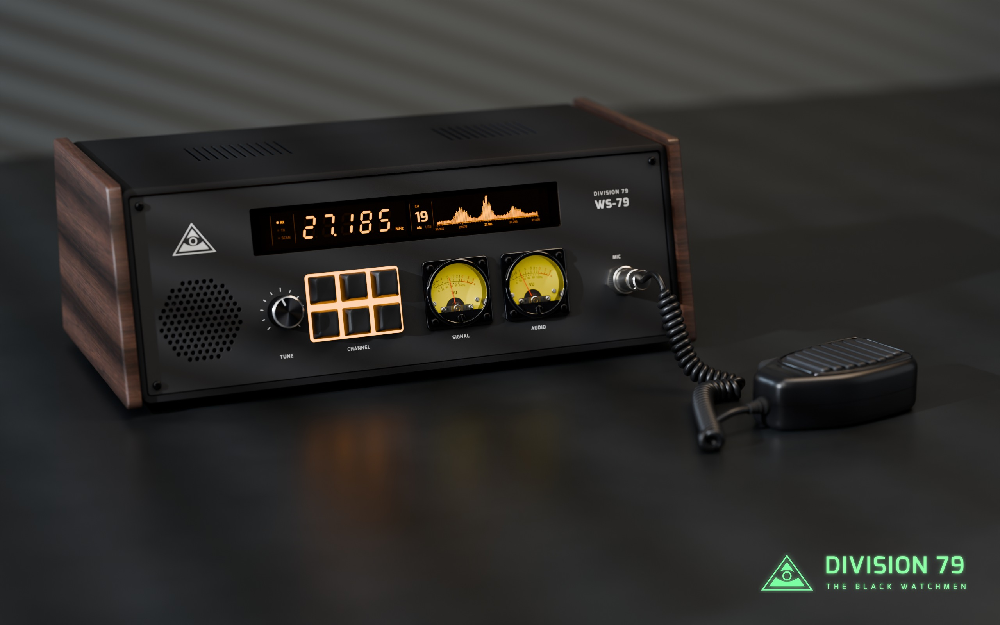

The WS-79 is the radio from **The Black Watchmen**. It sits on a desk and plays transmissions, and an agent decodes
some of them with the Stinger OS app. This repository holds what I use to build mine: the program for the Raspberry Pi,
the program for the screen, a utility that prepares the Pi's card from a Mac or a PC, the parts list, the wiring, and
the files for the case.

**[Parts](docs/PARTS-BOM.md) · [Wiring](docs/WIRING.md) · [Setup](docs/SETUP.md) · [How it works](docs/HOW-IT-WORKS.md) ·
[The case](print/README.md) · [Troubleshooting](docs/TROUBLESHOOTING.md) ·
[Contributing](.github/CONTRIBUTING.md)**

## The radio

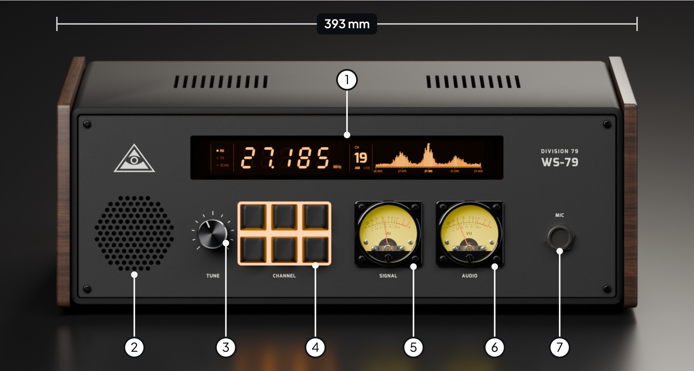

| Mark | Part |
|---|---|
| 1 | The window, with two bar displays behind it: the frequency on the left, the channel and the spectrum on the right |
| 2 | The speaker |
| 3 | The knob, which sets the volume |
| 4 | The six keys: five transmissions, and the colour of the screen |
| 5, 6 | The SIGNAL meter and the AUDIO meter |
| 7 | The socket of the hand microphone |

<p>
  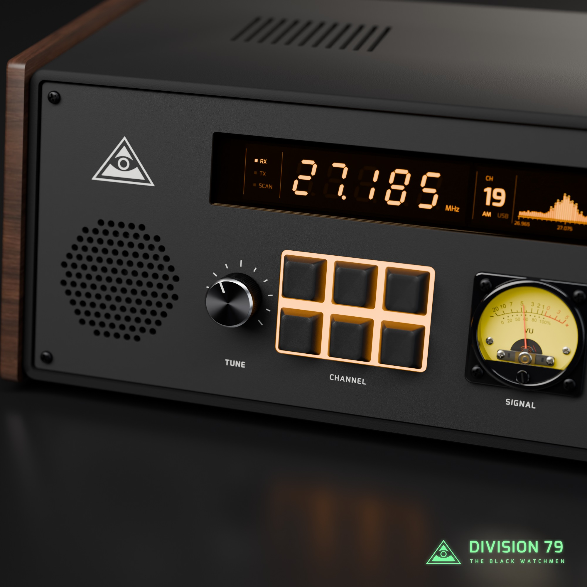
  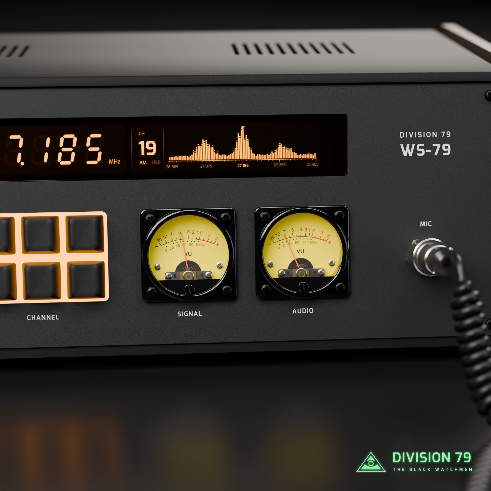
  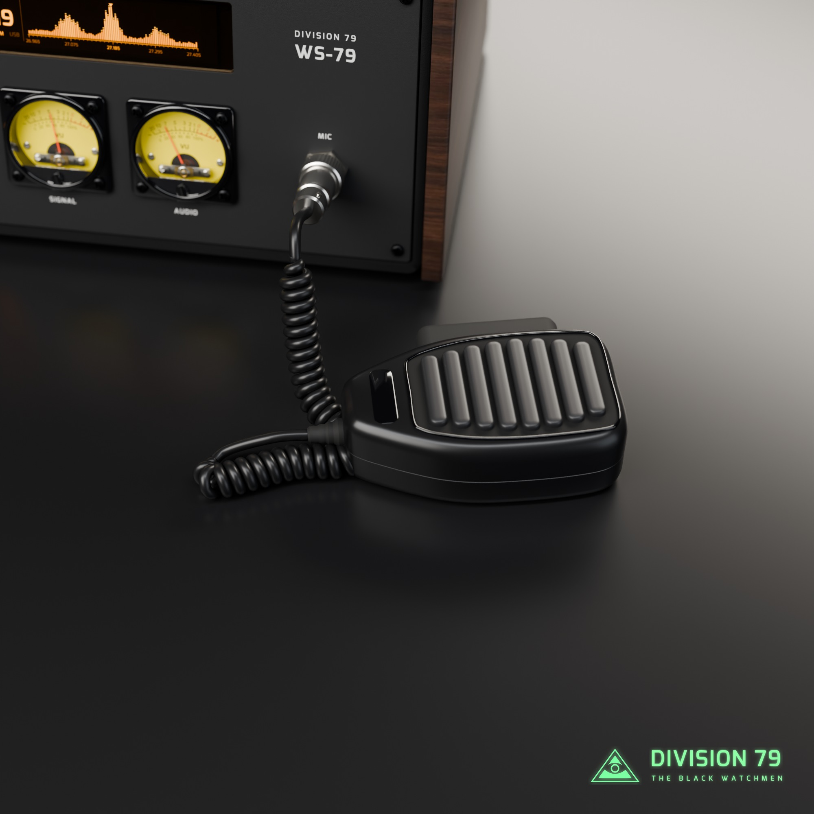
  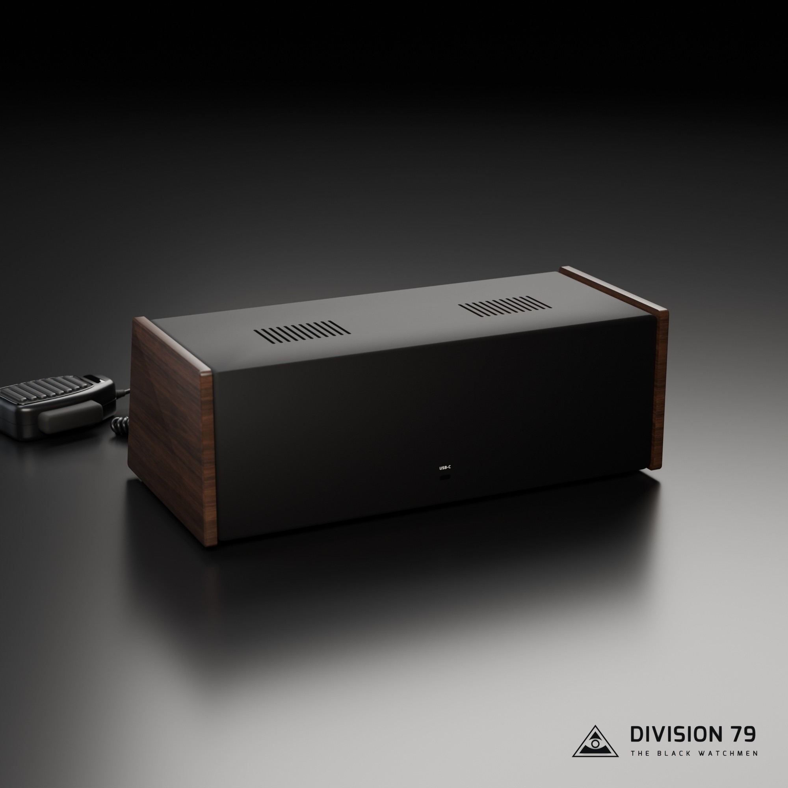
</p>

These pictures are renders of the 3D model. They show the finished radio: 393 mm wide, 193 mm deep and about 142 mm
tall, with two displays, two meters and a hand microphone. Version 1.0 is a step on the way: one display, the keys,
the knob and the speaker, running on a bench. [The case](print/README.md) gives the plans, with every opening of the
face and each part to print.

## Demo video

[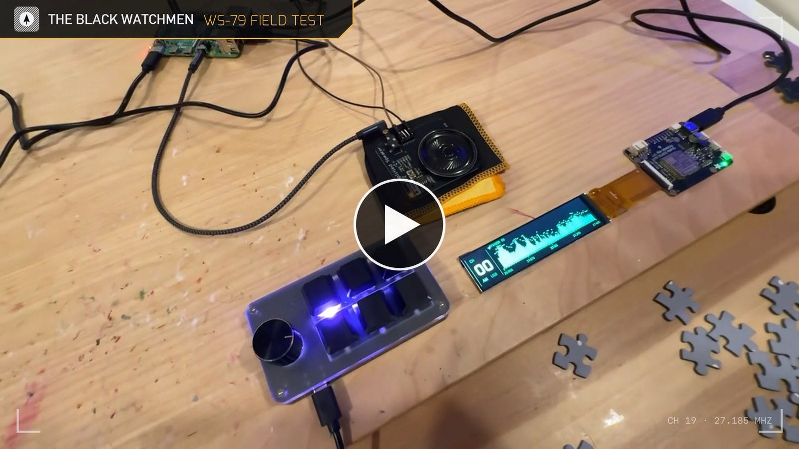](https://media.division79.com/ws79-field-test-0ebdb5dd4f.mp4)

I filmed the bench build on 15 November 2026. The radio sends a text file, then a picture, as sound. The Stinger OS
app on a phone hears each one and decodes it.
[Watch the video](https://media.division79.com/ws79-field-test-0ebdb5dd4f.mp4). It is 2 minutes long, and the file
is 58 MB. It is hosted outside this repository.

<p>
  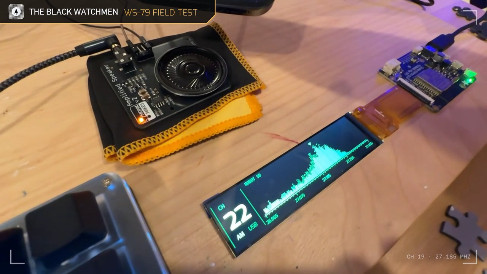
  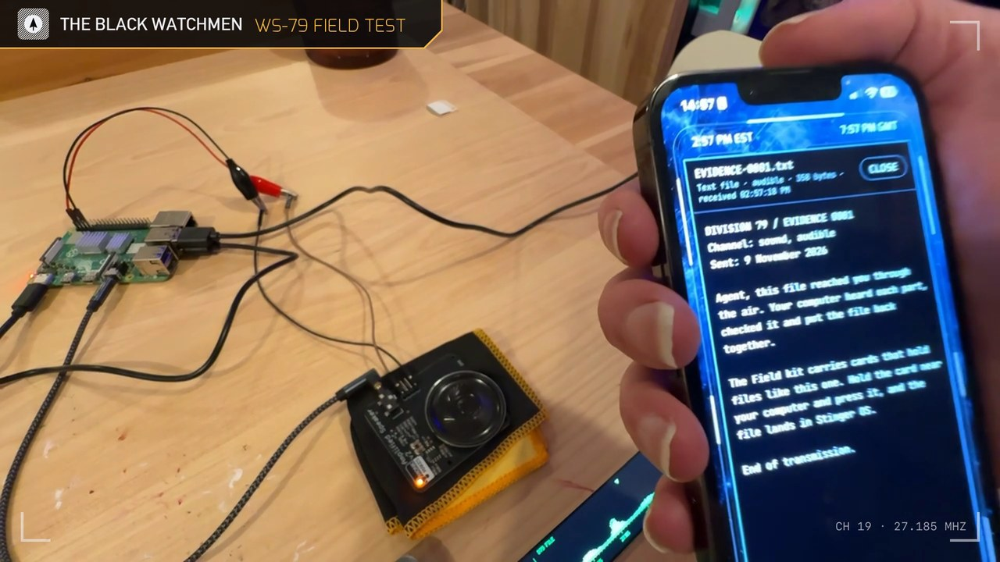
  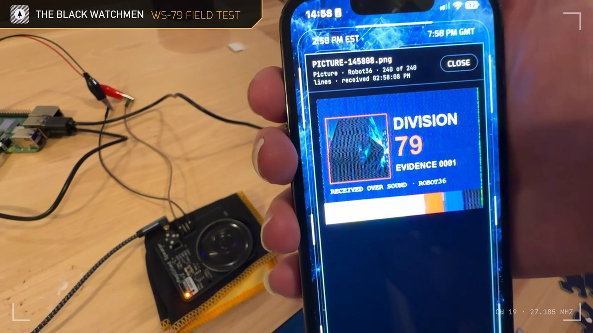
</p>

## Status of version 1.0

Version 1.0 is the first public version. It is the build that ran on my bench on 15 November 2026: a Raspberry Pi 4,
one bar screen, the keypad and the speaker, wired on a table. That build works from power-on to a decoded message.
The case is drawn and has not been printed. The meters, the microphone and the second screen are in the parts list and
are not wired yet, so the renders show where the build is going and the photos show where it is today.

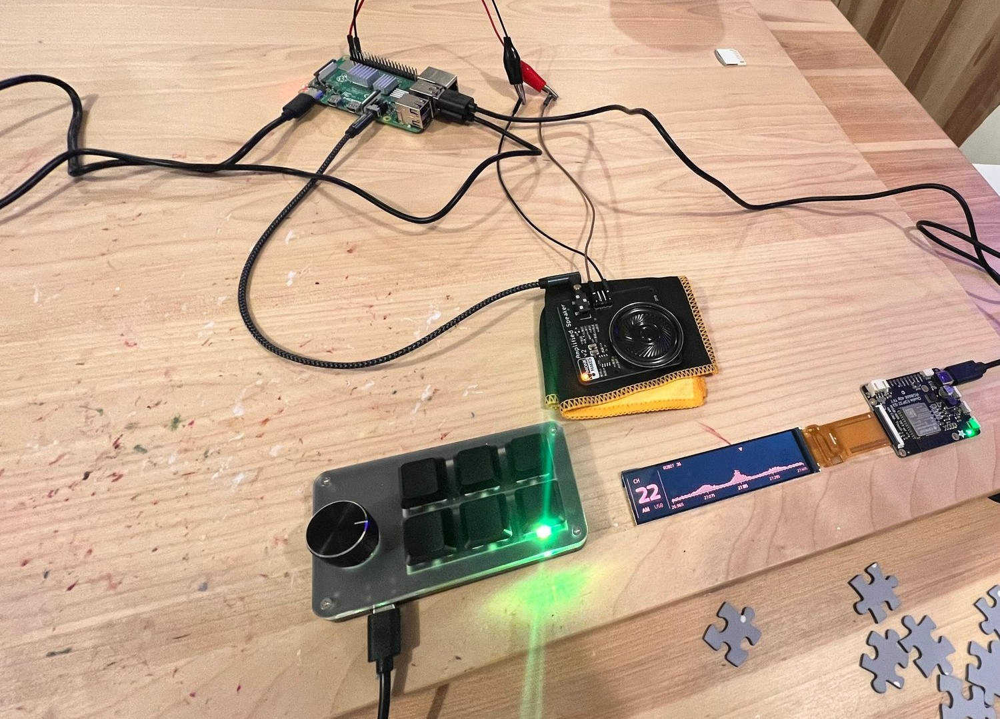

| | What it covers |
|---|---|
| **Tested on the bench** | The radio I filmed: its Pi program and its screen program with the keypad and the speaker, over several cold starts. Both data transmissions decoded with the app. Then the version in this repository, installed on the same Pi by `pi/install.sh`: a steady screen, the six keys with their sounds, and the knob. |
| **Tested on my Pi** | `pi/install.sh`, three times on 15 November 2026: on the radio as it was, on a screen board erased and waiting in its loader, and once more to see that a second run changes nothing. Each run ended with the radio running and with the files on the board matching this repository. After a restart of the Pi, the radio came back by itself. |
| **Tested on a computer** | 80 automated tests: the Pi program against a scripted keypad, the screen program against a stand-in for its display, the card utility against published test vectors and a folder that stands in for the card, the installer against stand-ins for the Pi's commands and devices, and the guides against the print files and the pictures they show. I also checked that the screen program here draws the same picture, frame for frame, as the one I filmed. |
| **Not tested yet** | `pi/install.sh` on a new card: my Pi already had its system packages, and its screen board went to its loader from CircuitPython. A board fresh from the factory takes another way there, which I did by hand once and the script has not done. `setup/setup_sd.py` has not set up a Pi from start to finish, and has not run on Windows or Linux. The case files have not been sliced or printed. |

This is a hobby build at low voltage. Check your wiring before you power it, and expect changes between versions.

## What the radio does

- It starts by itself. The screen shows the start, the network and READY, then the radio view.
- The screen shows the channel, a spectrum of 92 bars with peak dots, a frequency axis and a marker on the tuned
  channel. The spectrum follows the sound that is playing: the Pi sends it 20 times a second, and the screen redraws
  at up to 30 frames a second.
- Each key plays one transmission. The same key again stops it.
- The knob sets the volume. Pressing it mutes the sound.

| Key | Channel | What it plays |
|---|---|---|
| 1 | CH 0 · 26.965 MHz | Stinger OS coming online |
| 2 | CH 19 · 27.185 MHz | A numbers station |
| 3 | CH 40 · 27.405 MHz | A voice in the forest |
| 4 | CH 22 · 27.225 MHz | A picture sent as sound (Robot 36). The app decodes it. |
| 5 | CH 25 · 27.275 MHz | A file sent as sound. The app decodes it. |
| 6 | | The screen's colour: amber, blue, red, green |

<p>
  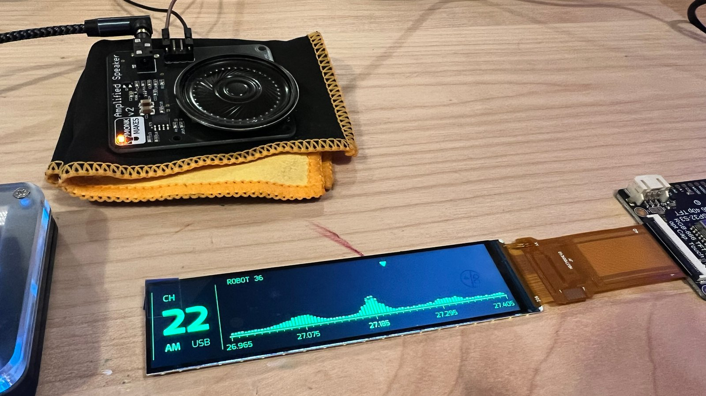
  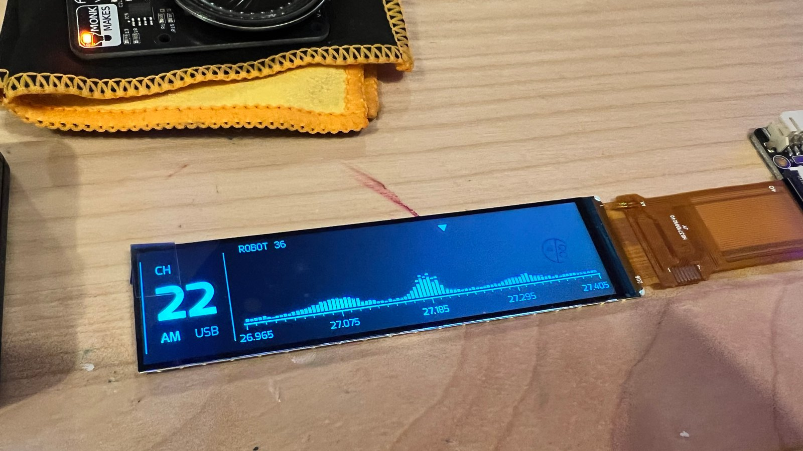
  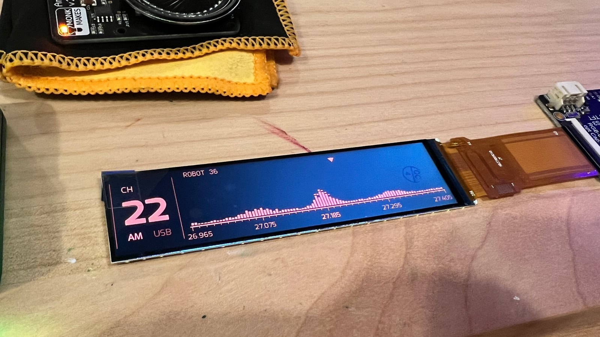
</p>

## What you need

- The parts marked **Wired** in [the parts list](docs/PARTS-BOM.md). Nothing needs soldering.
- A computer with Python 3.8 or later and a reader for the microSD card.
- [Raspberry Pi Imager](https://www.raspberrypi.com/software/) to write the system to the card.

## How to build it

1. **Wire the parts.** [docs/WIRING.md](docs/WIRING.md) has the table and photos of each connection.
2. **Prepare the card.** Write *Raspberry Pi OS (64-bit)* to the card with Raspberry Pi Imager, put the card back in
   your computer, then run the utility. It asks for the Pi's name, a user, your Wi-Fi and a password, sets up your
   SSH key, writes the card and checks what it wrote.
   ```bash
   python3 setup/setup_sd.py
   ```
   On Windows: `py setup\setup_sd.py`.
3. **Install the radio.** Start the Pi with the card in it and every part plugged in. Copy this folder to the Pi and
   run the installer there.
   ```bash
   scp -r ws79-radio pi@ws79.local:
   ssh pi@ws79.local
   ./ws79-radio/pi/install.sh
   ```
   The installer sets up the program and its service, programs the keypad and prepares the screen board. It asks
   before it erases a screen board that has no CircuitPython yet. It can run again at any time and skips what is
   already done.

[docs/SETUP.md](docs/SETUP.md) explains each of these steps, and [docs/TROUBLESHOOTING.md](docs/TROUBLESHOOTING.md)
lists the problems I ran into with their fixes.

## The guides

| Guide | What it holds |
|---|---|
| [Parts](docs/PARTS-BOM.md) | The 21 parts of the radio, A1 to A21, with a quantity, a picture and a sheet for each |
| [Wiring](docs/WIRING.md) | The bench build connection by connection, the pins of the Pi, and the wiring plan of the whole radio |
| [Setup](docs/SETUP.md) | The card, the first start and the installer, step by step |
| [How the radio works](docs/HOW-IT-WORKS.md) | The two programs, the messages between them, and how to change the sounds, the channels and the colours |
| [The case](print/README.md) | The plans of the case: its sizes, every opening of the face, the print files, and what is not drawn yet |
| [The model](model/README.md) | The Blender model the renders come from |
| [Troubleshooting](docs/TROUBLESHOOTING.md) | The problems I ran into, with what fixed each one |

## What is in this repository

| Folder | Contents |
|---|---|
| `pi/` | The radio program (`ws79.py`), its service, the keypad layout, the five sounds and `install.sh` |
| `screen/` | The screen program (`code.py`), its artwork and the display driver set to a 12 MHz clock |
| `setup/` | `setup_sd.py`, the card utility for Mac, Windows and Linux |
| `docs/` | The guides, the pictures of the parts and the wiring drawings |
| `print/` | The case parts as STL and 3MF files, and their plans |
| `model/` | The Blender model |
| `images/` | Renders, photos of the bench build and stills from the demo video |
| `tools/` | The scripts that draw the screen artwork, draw the case plans and convert STL to 3MF |
| `tests/` | The automated tests and the stand-ins they use for the Pi and the screen |

## Tests

```bash
python3 -m unittest discover -s tests
```

The tests need `numpy`, `pygame` and `Pillow`. They run the Pi program and the screen program on your computer, so
you can change either one and see what breaks before you touch the hardware. The installer's tests need `bash` and
the SSH key tests need `ssh-keygen`. Each group is skipped on a computer that does not have its tool.

## Licence and credits

The code is under the MIT licence ([LICENSE](LICENSE)). The case files, the model, the renders, the photos, the
drawings, the screen artwork and the sounds are under Creative Commons BY-NC-SA 4.0, with the exceptions listed in
[LICENSE-MEDIA.md](LICENSE-MEDIA.md). The pictures of the parts belong to their makers, and the demo video is not part
of this repository: neither licence covers them. The Black Watchmen and Division 79 names and logos are not part of
either licence. [CREDITS.md](CREDITS.md) names the parts, the software and the works this build relies on.
