# Parts

The list covers the whole radio, in 21 numbered parts. The drawings in [WIRING.md](WIRING.md) and in
[the case plans](../print/README.md) call each part by its number here. The last column says where the part stands in
version 1.0: **wired** means it runs in the bench build, and **planned** means it is in the design and not connected
yet.

The references are the parts I ordered. Any equivalent part works, except where a note says otherwise. The sizes and
the electrical values come from each maker's or seller's page, read on 10 and 14 November 2026. I have measured none of
them myself. The openings of the case are another matter: they are measured in its print files.

## The list

| &nbsp;&nbsp;&nbsp;&nbsp;&nbsp;&nbsp;&nbsp;&nbsp;&nbsp;&nbsp;&nbsp;&nbsp;&nbsp;&nbsp;&nbsp;&nbsp;&nbsp;&nbsp;&nbsp;&nbsp;&nbsp;&nbsp;&nbsp;&nbsp; | No. | Part | What it does | In version 1.0 |
|---|---|---|---|---|
| 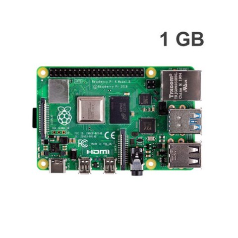 | 1 | [Raspberry Pi 4 Model B, 1 GB](#part-1) | Runs the radio program, plays the sounds and drives the screen | Wired |
| 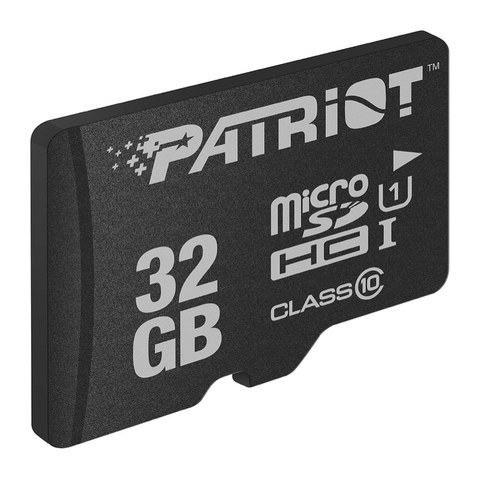 | 2 | [microSD card, 32 GB](#part-2) | Holds Raspberry Pi OS and the radio program | Wired |
| 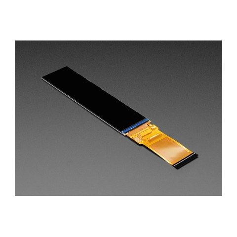 | 3 | [3.7 in bar display, 240 × 960 pixels](#part-3) | Shows the channel and the spectrum. The finished radio has two, end to end | One wired, one planned |
| 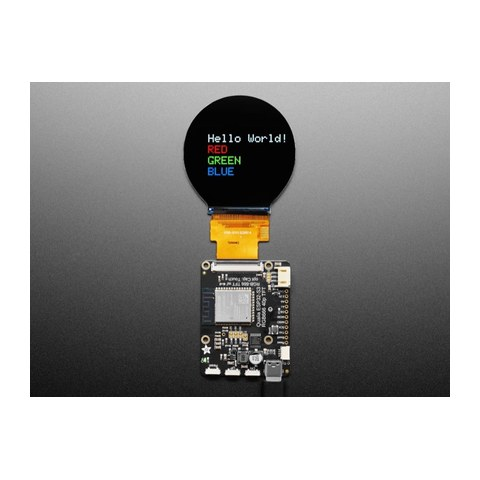 | 4 | [Qualia ESP32-S3 board for RGB-666 displays](#part-4) | Drives one bar display. The Pi talks to it over USB | Wired |
| 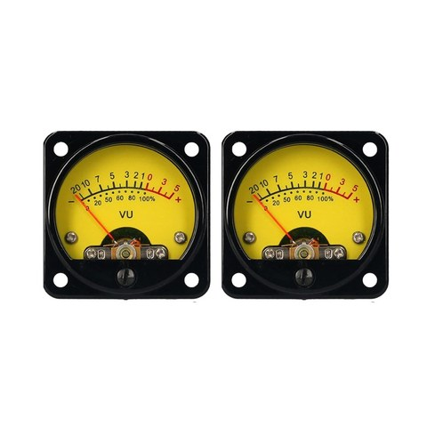 | 5 | [Pair of VU meters, 0 to 500 µA](#part-5) | The SIGNAL and AUDIO needles | Planned |
| 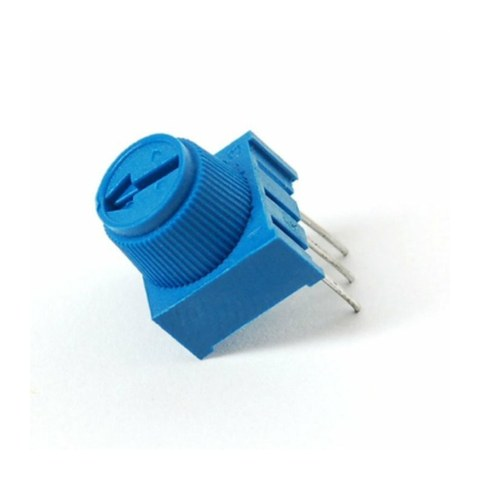 | 6 | [10 kΩ trim potentiometer](#part-6) | Sets the full scale of each needle | Planned |
| 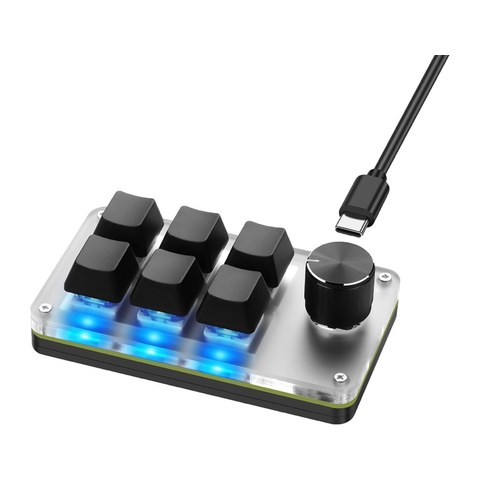 | 7 | [SinLoon keypad, 6 keys and a knob](#part-7) | The channel keys and the volume knob | Wired |
| 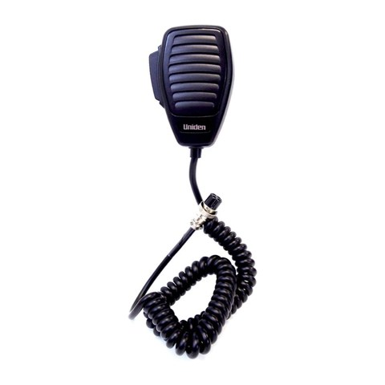 | 8 | [Uniden BC645 CB microphone](#part-8) | The hand microphone and its push-to-talk button | Planned |
| 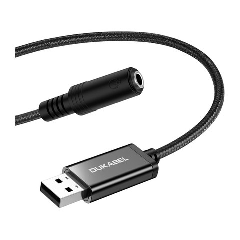 | 9 | [USB sound adapter with a microphone input](#part-9) | The microphone's way into the Pi | Planned |
| 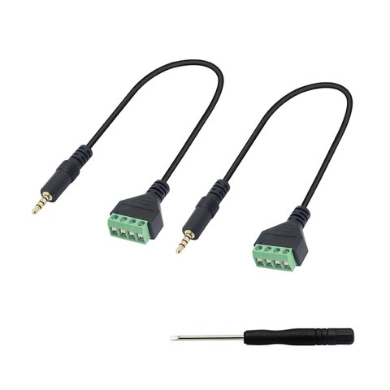 | 10 | [3.5 mm TRRS plug with screw terminals](#part-10) | Joins the microphone socket to the sound adapter without soldering | Planned |
| 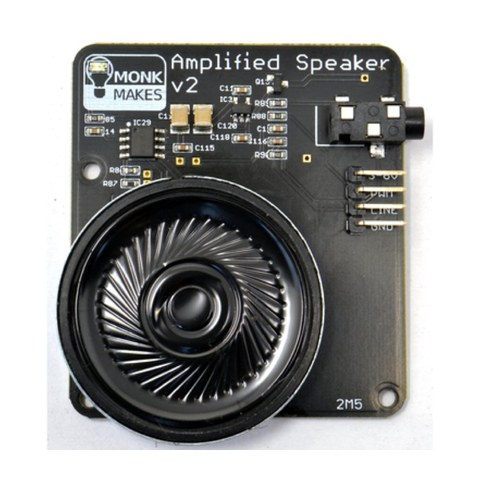 | 11 | [MonkMakes Amplified Speaker 2](#part-11) | The speaker, with its own amplifier | Wired |
| 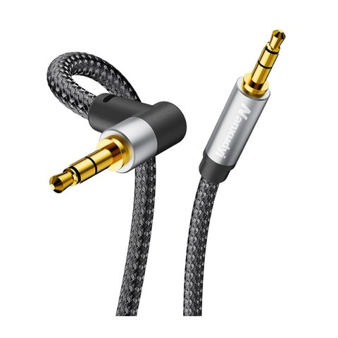 | 12 | [3.5 mm audio cable, 30 cm, one end at a right angle](#part-12) | Takes the sound from the Pi's jack to the speaker | Wired |
| 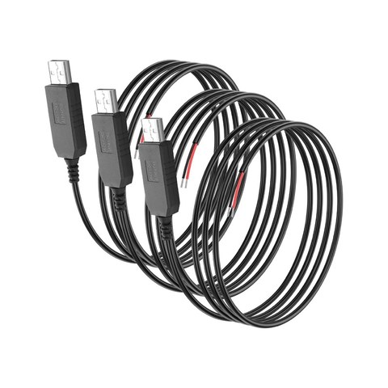 | 13 | [USB 5 V to 12 V step-up cable](#part-13) | Makes the 12 V for the meters' lamps | Planned |
| 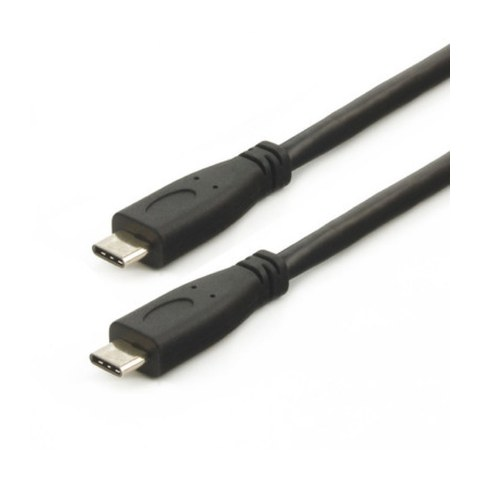 | 14 | [USB-C to USB-C cable, 91 cm](#part-14) | Powers the finished radio from a computer. It is the only cable that leaves the case | Planned |
| 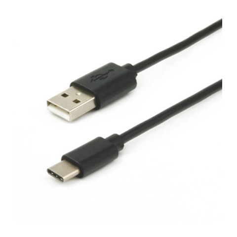 | 15 | [USB-A to USB-C cable, 91 cm](#part-15) | Connects the Pi to the Qualia board | Wired |
| 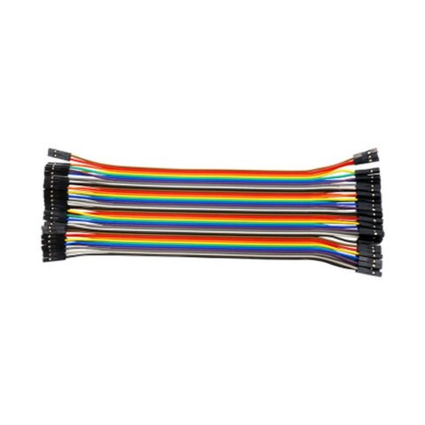 | 16 | [Jumper wires and clip leads](#part-16) | Bring 5 V and ground from the Pi's pins to the speaker | Wired |
| 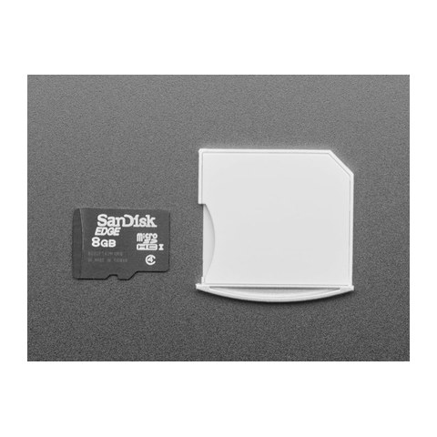 | 17 | [microSD to SD adapter](#part-17) | Lets a computer's SD slot write the card | Wired |
|  | 18 | [Second Qualia ESP32-S3 board](#part-18) | Drives the second bar display | Planned |
|  | 19 | [Second USB-A to USB-C cable](#part-19) | Connects the second Qualia board to the Pi | Planned |
|  | 20 | [USB-A socket on four jumper wires](#part-20) | Brings 5 V from the Pi's header to the step-up cable | Planned |
|  | 21 | [4-pin chassis socket for a CB microphone](#part-21) | Lets the microphone plug into the front panel | Planned |

Three notes on these parts.

- **The keypad must be this model.** The installer programs it over USB, and the tool it uses only speaks to keypads
  built on the CH57x chip that identify as `1189:8890`.
- **The screen and its board must be these two.** The screen program is written for the Qualia board and the
  240 × 960 bar.
- **Two female-to-female jumper wires replace part 16.** The clips of the leads are too wide for pins that sit
  2.54 mm apart, which is why the bench build chains a jumper wire and a clip lead. A wire with a socket at each end
  goes straight from the Pi's pin to the speaker's pin.

## The sheets

One sheet for each part, in the order of the list.

### 1. Raspberry Pi 4 Model B, 1 GB

| | |
|---|---|
|  | Runs the radio program, plays the sounds and drives the screen.  **Quantity:** 1 **In version 1.0:** wired **Reference:** PiShop 1GB-9002 **Comes with:** A 5.1 V 3 A USB-C power supply and 3 heat sinks **Processor:** Broadcom BCM2711, four Cortex-A72 cores **Memory:** 1 GB **Ports:** 2 USB 3.0, 2 USB 2.0, USB-C for power **Header:** 40 pins **Audio:** 3.5 mm jack, 4 poles **Board:** 85 × 56 mm **Maker's page:** https://datasheets.raspberrypi.com/rpi4/raspberry-pi-4-product-brief.pdf |

### 2. microSD card, 32 GB

| | |
|---|---|
|  | Holds Raspberry Pi OS and the radio program.  **Quantity:** 1 **In version 1.0:** wired **Reference:** Patriot 32 GB, Amazon B08KSSXKYR **Capacity:** 32 GB, microSDHC **Adapter:** None in the box. Part 17 is the adapter. |

### 3. 3.7 in bar display, 240 × 960 pixels

| | |
|---|---|
|  | Shows the channel and the spectrum. The finished radio has two, end to end.  **Quantity:** 2 **In version 1.0:** one wired, one planned **Reference:** Adafruit 5799 **Model:** HD371001C40, no touch screen **Driver:** ST7701S **Interface:** TTL RGB on a 40-pin ribbon **Outline:** 98.89 × 25.3 mm **Lit area:** 91.44 × 22.86 mm **Ribbon:** 20.5 mm wide, 50 mm long **Maker's page:** https://www.adafruit.com/product/5799 |

### 4. Qualia ESP32-S3 board for RGB-666 displays

| | |
|---|---|
|  | Drives one bar display. The Pi talks to it over USB.  **Quantity:** 1 **In version 1.0:** wired **Reference:** Adafruit 5800 **Chip:** ESP32-S3, 16 MB of flash, 8 MB of PSRAM **Display connector:** 40 pins, RGB-666 **USB:** USB-C, for power and programming **Board:** 58 × 43 mm **Maker's page:** https://learn.adafruit.com/adafruit-qualia-esp32-s3-for-rgb666-displays |

### 5. Pair of VU meters, 0 to 500 µA

| | |
|---|---|
|  | The SIGNAL and AUDIO needles.  **Quantity:** 1 pair **In version 1.0:** planned **Reference:** Amazon B0GV1VC7PZ **In the box:** 2 meters and 2 driver boards **Scale:** 0 to 500 µA **Size:** 46 × 48 × 46 mm each **Lamp:** 12 V LED **Driver boards:** 6 to 12 V in, 55 mA |

### 6. 10 kΩ trim potentiometer

| | |
|---|---|
|  | Sets the full scale of each needle.  **Quantity:** 2 **In version 1.0:** planned **Reference:** PiShop 88 **Value:** 10 kΩ **Pins:** 3, spaced 2.54 mm |

### 7. SinLoon keypad, 6 keys and a knob

| | |
|---|---|
|  | The channel keys and the volume knob.  **Quantity:** 1 **In version 1.0:** wired **Reference:** Amazon B0DN9T9J75, model SL2024502 **Keys:** 6 mechanical keys and 1 knob that turns and presses **Light:** RGB, under the keys **Connection:** USB-C, cable in the box **USB identity:** `1189:8890`, which the installer looks for |

### 8. Uniden BC645 CB microphone

| | |
|---|---|
|  | The hand microphone and its push-to-talk button.  **Quantity:** 1 **In version 1.0:** planned **Reference:** Amazon B008CLIB5K **Plug:** 4 pins, wired the Cobra and Uniden way **Cord:** Coiled, 2.4 m **Button:** Push to talk |

### 9. USB sound adapter with a microphone input

| | |
|---|---|
|  | The microphone's way into the Pi.  **Quantity:** 1 **In version 1.0:** planned **Reference:** DuKabel, Amazon B07RS11M1T **Jack:** 3.5 mm, 4 poles (TRRS), microphone and output **Standard:** CTIA **Cable:** Braided, 25 cm |

### 10. 3.5 mm TRRS plug with screw terminals

| | |
|---|---|
|  | Joins the microphone socket to the sound adapter without soldering.  **Quantity:** 1 of a pack of 2 **In version 1.0:** planned **Reference:** Amazon B08QFHHJ3Z **Plug:** 3.5 mm male, 4 poles **Terminals:** 4 screw terminals **Length:** 32 cm |

### 11. MonkMakes Amplified Speaker 2

| | |
|---|---|
|  | The speaker, with its own amplifier.  **Quantity:** 1 **In version 1.0:** wired **Reference:** PiShop 348-1 **Power:** 3.3 to 6 V, 300 mA at most **Speaker:** 8 Ω, 500 mW **Input:** 3.5 mm jack **Size:** 51 × 56 × 61 mm **Maker's page:** https://monkmakes.com/downloads/datasheet_amp_speaker_2.pdf |

### 12. 3.5 mm audio cable, 30 cm, one end at a right angle

| | |
|---|---|
|  | Takes the sound from the Pi's jack to the speaker.  **Quantity:** 1 **In version 1.0:** wired **Reference:** Amazon B08F2GRHXC **Plugs:** 3.5 mm male at both ends, one at 90° **Length:** 30 cm |

### 13. USB 5 V to 12 V step-up cable

| | |
|---|---|
|  | Makes the 12 V for the meters' lamps.  **Quantity:** 1 of a pack of 3 **In version 1.0:** planned **Reference:** SinLoon, Amazon B0F2YKGS25 **Input:** USB-A, 5 V, 2 A at most **Output:** 12 V, 0.8 A at most, on bare wires **Length:** 88 cm |

### 14. USB-C to USB-C cable, 91 cm

| | |
|---|---|
|  | Powers the finished radio from a computer. It is the only cable that leaves the case.  **Quantity:** 1 **In version 1.0:** planned **Reference:** PiShop 700-1 **Standard:** USB 3.2 Gen 2 **Length:** 91 cm (3 ft) |

### 15. USB-A to USB-C cable, 91 cm

| | |
|---|---|
|  | Connects the Pi to the Qualia board.  **Quantity:** 1 **In version 1.0:** wired **Reference:** PiShop CS-PID-45 **Standard:** USB 2.0. It must be a data cable. **Length:** 91 cm (3 ft). A shorter one fits the case better. |

### 16. Jumper wires and clip leads

| | |
|---|---|
|  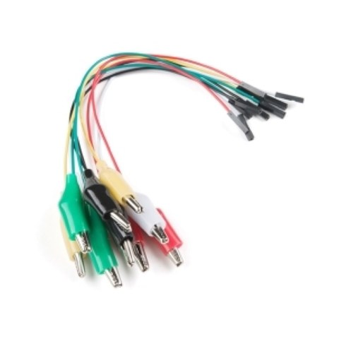 | Bring 5 V and ground from the Pi's pins to the speaker.  **Quantity:** 2 wires of 40, 2 leads of 10 **In version 1.0:** wired **References:** PiShop 283 for the wires, SparkFun 15186 for the leads **Jumper wires:** Male to female, 20 cm, sockets spaced 2.54 mm **Clip leads:** A clip at one end, a female socket at the other, 30 cm **Maker's page:** https://www.sparkfun.com/products/15186 |

### 17. microSD to SD adapter

| | |
|---|---|
|  | Lets a computer's SD slot write the card.  **Quantity:** 1 **In version 1.0:** wired **Reference:** Adafruit 5447 **Format:** microSD to SD, short version **Maker's page:** https://www.adafruit.com/product/5447 |

### 18. Second Qualia ESP32-S3 board

| | |
|---|---|
|  | Drives the second bar display.  **Quantity:** 1 **In version 1.0:** planned **Reference:** Adafruit 5800, the same board as part 4 **Maker's page:** https://www.adafruit.com/product/5800 |

### 19. Second USB-A to USB-C cable

| | |
|---|---|
|  | Connects the second Qualia board to the Pi.  **Quantity:** 1 **In version 1.0:** planned **Reference:** PiShop CS-PID-45, the same cable as part 15 |

### 20. USB-A socket on four jumper wires

Brings 5 V from the Pi's header to the step-up cable.

**Quantity:** 1 **In version 1.0:** planned **Reference:** Adafruit 4449 **Socket:** USB-A female, on a 30 cm cable **Wires:** Four female ends spaced 2.54 mm. Red is 5 V and black is ground. Green and white are the data lines and stay free. **Maker's page:** https://www.adafruit.com/product/4449

### 21. 4-pin chassis socket for a CB microphone

Lets the microphone plug into the front panel.

**Quantity:** 1 **In version 1.0:** planned **Reference:** A 4-pin male chassis socket, of the kind used on Cobra and Uniden radios **Mounting:** In the 16.2 mm hole of the face. Try it with the microphone's plug before you mount it.

## Where the pictures come from

The pictures of the parts are the product pictures of their makers and sellers. They belong to their owners and
are here to identify the parts. They are not covered by this repository's licence
([LICENSE-MEDIA.md](../LICENSE-MEDIA.md)). Parts 20 and 21 have no picture yet.
