# Parts

The radio has 23 parts, labelled A1 to A23. One place needs soldering: the two lamp holes on each meter's driver
board, four joints in all. Nothing else is soldered. The drawings in [WIRING.md](WIRING.md) and in
[the case plans](../print/README.md) call each part by its label. The last column says where the part stands in
version 1.0: **wired** means it is part of the bench build, and **planned** means it is in the design and not connected
yet.

Each reference is the part I picked for the radio. Any
equivalent part works, except where a note says otherwise. The sizes and the electrical values come from each maker's
or seller's page, read between 10 and 16 November 2026. I have measured none of them myself. The openings of the case
are another matter: they are measured in its print files.

## The list

| No. | &nbsp;&nbsp;&nbsp;&nbsp;&nbsp;&nbsp;&nbsp;&nbsp;&nbsp;&nbsp;&nbsp;&nbsp;&nbsp;&nbsp;&nbsp;&nbsp;&nbsp;&nbsp;&nbsp;&nbsp;&nbsp;&nbsp;&nbsp;&nbsp; | Part | Qty | What it does | In version 1.0 |
|---|---|---|---|---|---|
| **A1** | 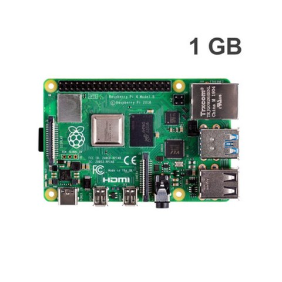 | [Raspberry Pi 4 Model B, 1 GB](#a1) | **×1** | Runs the radio program, plays the sounds and drives the screens | Wired |
| **A2** | 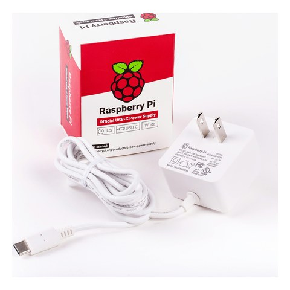 | [USB-C power supply, 5.1 V 3 A](#a2) | **×1, came with A1** | Powers the whole radio through one cable | Wired |
| **A3** | 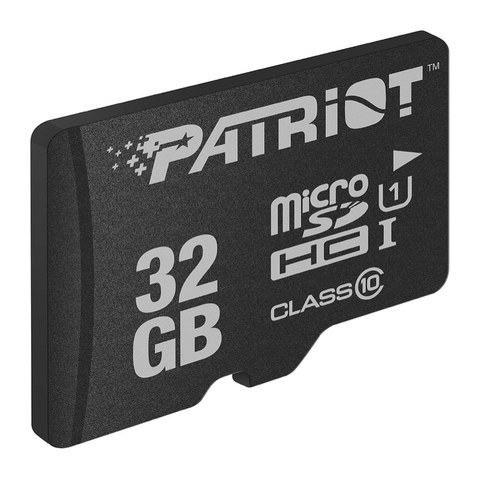 | [microSD card, 32 GB](#a3) | **×1** | Holds Raspberry Pi OS and the radio program | Wired |
| **A4** | 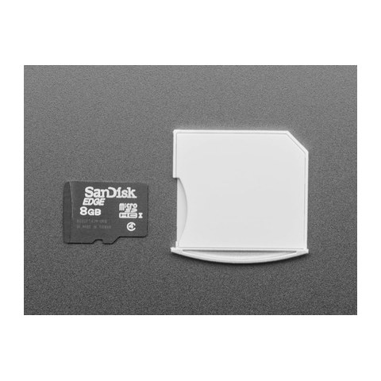 | [microSD to SD adapter](#a4) | **×1** | Lets a computer's SD slot write the card | Wired |
| **A5** | 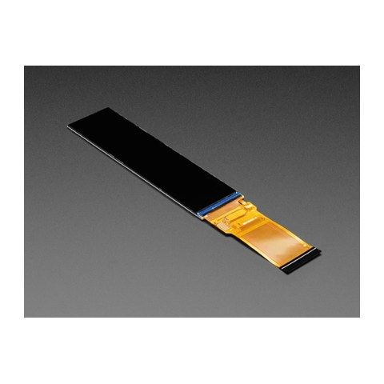 | [3.7 in bar display, 240 × 960 pixels](#a5) | **×2** | Shows the frequency, the channel and the spectrum. The two sit end to end behind the window | One wired, one planned |
| **A6** | 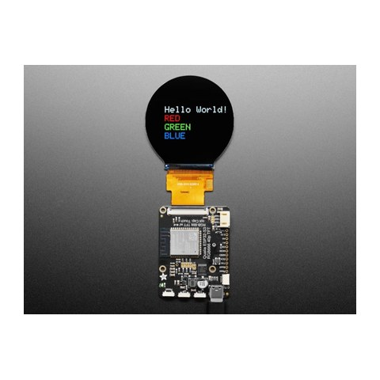 | [Qualia ESP32-S3 board for RGB-666 displays](#a6) | **×2** | Drives one bar display each. The Pi talks to each board over USB | One wired, one planned |
| **A7** | 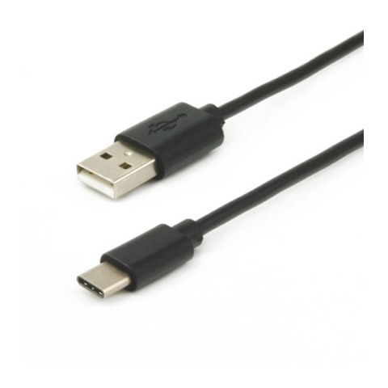 | [USB-A to USB-C cable, 91 cm](#a7) | **×3** | Connects the Pi to each Qualia board, and to the keypad | Two wired, one planned |
| **A8** | 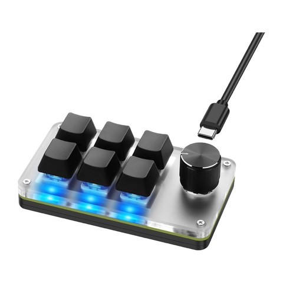 | [SinLoon keypad, 6 keys and a knob](#a8) | **×1** | The channel keys and the volume knob | Wired |
| **A9** | 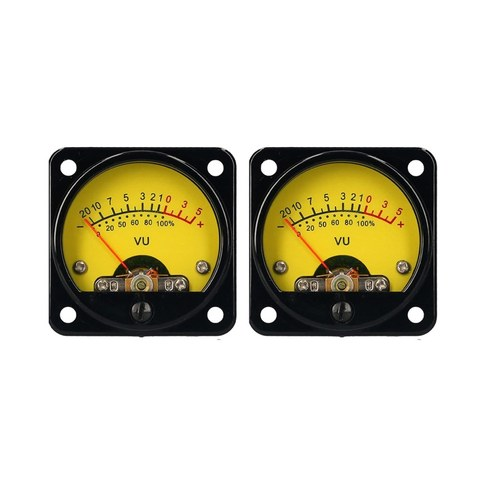 | [Pair of VU meters, 0 to 500 µA](#a9) | **×1 pair** | The SIGNAL and AUDIO needles | Planned |
| **A10** | 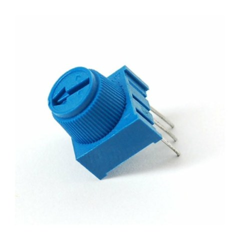 | [10 kΩ trim potentiometer](#a10) | **×2** | Sets the full scale of each needle | Planned |
| **A11** | 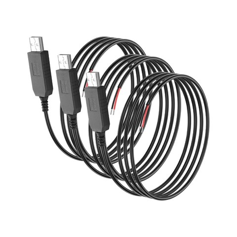 | [USB 5 V to 12 V step-up cable](#a11) | **×1** | Turns 5 V into the 12 V that lights the meters | Planned |
| **A12** | 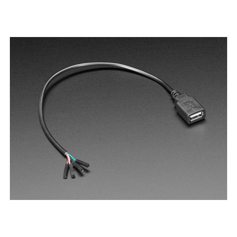 | [USB-A socket on four jumper wires](#a12) | **×1** | Gives the step-up cable a USB socket on the Pi's header | Planned |
| **A13** | 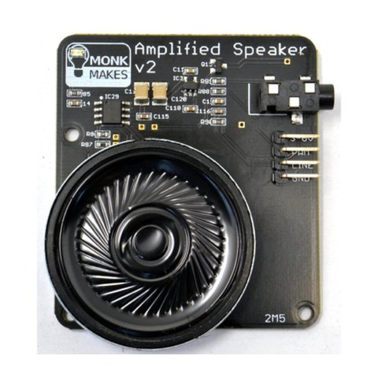 | [MonkMakes Amplified Speaker 2](#a13) | **×1** | The speaker, with its own amplifier | Wired |
| **A14** | 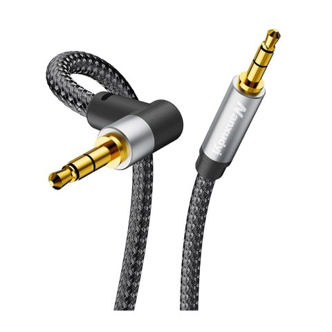 | [3.5 mm audio cable, 30 cm, one end at a right angle](#a14) | **×1** | Takes the sound from the Pi's jack to the speaker | Wired |
| **A15** | 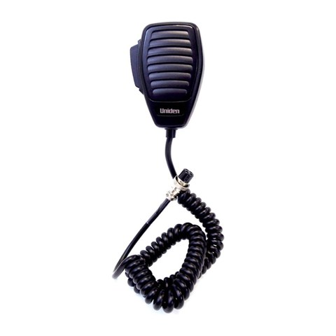 | [Uniden BC645 CB microphone](#a15) | **×1** | The hand microphone and its push-to-talk button | Planned |
| **A16** | 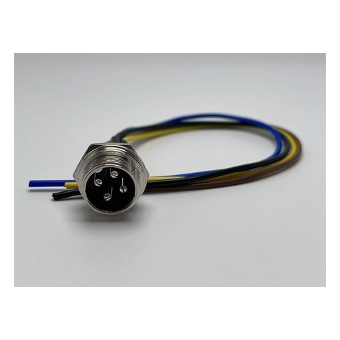 | [GX16 4-pin socket with its wires attached](#a16) | **×1** | The socket that the microphone plugs into | Planned |
| **A17** | 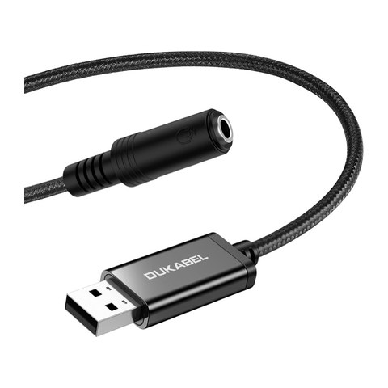 | [USB sound adapter with a microphone input](#a17) | **×1** | Gives the Pi the microphone input it lacks | Planned |
| **A18** | 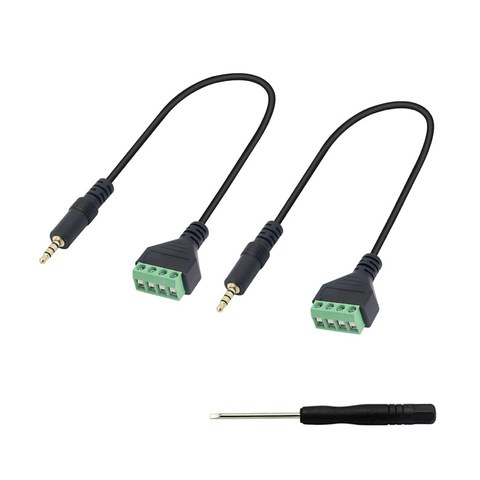 | [3.5 mm TRRS plug with screw terminals](#a18) | **×1** | Joins the microphone's wires to the sound adapter | Planned |
| **A19** | 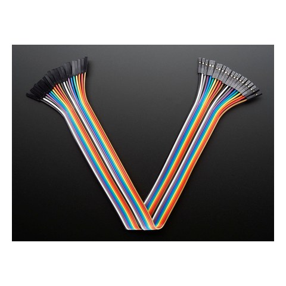 | [Female-to-female jumper wires, 30 cm](#a19) | **×1 strip of 20** | Join the Pi's pins to the speaker, the needles and the push-to-talk button | Wired |
| **A20** | 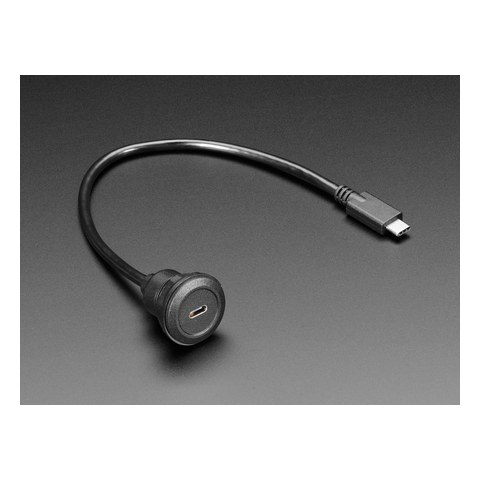 | [USB-C panel socket on a 30 cm cable](#a20) | **×2** | The two sockets on the back of the case: power, and the PC | Planned |
| **A21** | 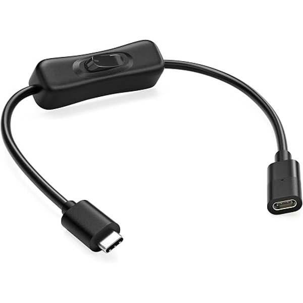 | [USB-C cable with a rocker switch](#a21) | **×1** | The master switch | Planned |
| **A22** | 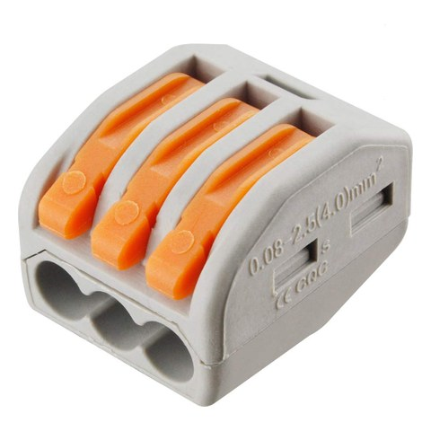 | [Lever connectors for thin wire, 3 ways](#a22) | **×1 pack of 50** | Join the microphone socket's wires to jumper wires, with no soldering | Planned |
| **A23** | 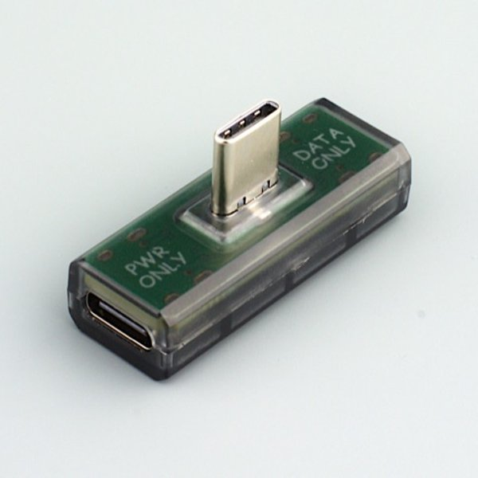 | [USB-C power and data splitter](#a23) | **×1** | Gives the Pi its power from the supply and its data from the PC | Planned |

Five notes on these parts.

- **The keypad must be this model.** The installer programs it over USB, and the tool it uses only speaks to keypads
  built on the CH57x chip that identify as `1189:8890`.
- **The screens and their boards must be these two.** The screen program is written for the Qualia board and the
  240 × 960 bar.
- **Use wires with a socket at each end on the Pi's pins.** The bench build first used crocodile clip leads. Their
  clips are too wide for pins that sit 2.54 mm apart and they did not hold, so A19 replaces them.
- **A2 comes with A1 in the kit.** My Pi came with its power supply in the same order. Buy A2 only if your Pi
  comes without one. The radio needs one supply.
- **One cable powers everything.** The supply A2 plugs into a socket A20 on the back. Inside, the switch cable A21
  takes the power to the splitter A23, then to the Pi, and the Pi powers every other part through its USB ports and its
  header. A second cable, to a PC, is optional: it plugs into the second socket A20 and carries data only. A PC's USB
  port cannot power the radio, so the supply stays plugged in.
  [WIRING.md](WIRING.md#power) shows the path.

## The sheets

One sheet for each part, in the order of the list.

### A1. Raspberry Pi 4 Model B, 1 GB

| | |
|---|---|
|  | Runs the radio program, plays the sounds and drives the screens. Every other part takes its power from it.  **Quantity:** ×1 **In version 1.0:** wired **Reference:** PiShop 1GB-9002, bought with a power supply (A2) and 3 heat sinks **Connects:** Every other part connects to it. [The diagram](WIRING.md#every-part-and-every-link) shows each link. **Processor:** Broadcom BCM2711, four Cortex-A72 cores **Memory:** 1 GB **Ports:** 2 USB 3.0, 2 USB 2.0, USB-C for power **Header:** 40 pins **Audio:** 3.5 mm jack, 4 poles **Board:** 85 × 56 mm **Maker's page:** https://datasheets.raspberrypi.com/rpi4/raspberry-pi-4-product-brief.pdf |

### A2. USB-C power supply, 5.1 V 3 A

| | |
|---|---|
|  | Powers the whole radio. Its cable is the only one that leaves the case: it plugs into the socket A20 on the back.  **Quantity:** ×1, came with A1 **In version 1.0:** wired **Reference:** The supply that came with A1 in my order. Raspberry Pi's own 15 W USB-C supply is the model to buy on its own, and the one the switch cable A21 is made for. **Connects:** Its cable plugs into the socket A20, direct. On the bench it plugs straight into the Pi. **Output:** 5.1 V, 3 A **Plug:** USB-C. On Raspberry Pi's own supply it ends a 1.5 m cable that does not come off. **Maker's page:** https://www.raspberrypi.com/products/type-c-power-supply/ |

### A3. microSD card, 32 GB

| | |
|---|---|
|  | Holds Raspberry Pi OS and the radio program.  **Quantity:** ×1 **In version 1.0:** wired **Reference:** Patriot 32 GB, Amazon B08KSSXKYR **Connects:** Goes into the Pi's microSD slot, direct. **Capacity:** 32 GB, microSDHC **Adapter:** None in the box. A4 is the adapter. |

### A4. microSD to SD adapter

| | |
|---|---|
|  | Lets a computer's SD slot write the card.  **Quantity:** ×1 **In version 1.0:** wired **Reference:** Adafruit 5447 **Connects:** Holds A3 in a computer's SD slot while you prepare the card. It does not go in the radio. **Format:** microSD to SD, short version **Maker's page:** https://www.adafruit.com/product/5447 |

### A5. 3.7 in bar display, 240 × 960 pixels

| | |
|---|---|
|  | Shows the frequency, the channel and the spectrum. The finished radio has two, end to end behind the window.  **Quantity:** ×2 **In version 1.0:** one wired, one planned **Reference:** Adafruit 5799 **Connects:** Its ribbon goes straight into the Qualia board A6, direct. **Model:** HD371001C40, no touch screen **Driver:** ST7701S **Interface:** TTL RGB on a 40-pin ribbon **Outline:** 98.89 × 25.3 mm **Lit area:** 91.44 × 22.86 mm **Ribbon:** 20.5 mm wide, 50 mm long **Maker's page:** https://www.adafruit.com/product/5799 |

### A6. Qualia ESP32-S3 board for RGB-666 displays

| | |
|---|---|
|  | Drives one bar display. Each display has its own board, and the Pi talks to each board over USB.  **Quantity:** ×2 **In version 1.0:** one wired, one planned **Reference:** Adafruit 5800 **Connects:** A USB-A port of the Pi, with A7. The ribbon of A5, direct. **Chip:** ESP32-S3, 16 MB of flash, 8 MB of PSRAM **Display connector:** 40 pins, RGB-666 **USB:** USB-C, for power and programming **Board:** 58 × 43 mm **Maker's page:** https://learn.adafruit.com/adafruit-qualia-esp32-s3-for-rgb666-displays |

### A7. USB-A to USB-C cable, 91 cm

| | |
|---|---|
|  | Connects a USB-A port of the Pi to a Qualia board. The third one goes to the keypad, in place of the keypad's own cable.  **Quantity:** ×3 **In version 1.0:** two wired, one planned **Reference:** PiShop CS-PID-45 **Connects:** Two go from USB-A ports of the Pi to the two Qualia boards A6. One goes from a USB-A port to the keypad A8. **Standard:** USB 2.0. It must be a data cable. **Length:** 91 cm (3 ft). A shorter one fits the case better. |

### A8. SinLoon keypad, 6 keys and a knob

| | |
|---|---|
|  | The channel keys and the volume knob.  **Quantity:** ×1 **In version 1.0:** wired **Reference:** Amazon B0DN9T9J75, model SL2024502 **Connects:** A USB-A port of the Pi, with A7. **Keys:** 6 mechanical keys and 1 knob that turns and presses **Light:** RGB, under the keys **Connection:** USB-C, cable in the box **USB identity:** `1189:8890`, which the installer looks for |

### A9. Pair of VU meters, 0 to 500 µA

| | |
|---|---|
|  | The SIGNAL and AUDIO needles.  **Quantity:** ×1 pair **In version 1.0:** planned **Reference:** Amazon B0GV1VC7PZ **Connects:** Each needle: a pin of the Pi, the potentiometer A10, then the meter's + terminal, with A19 wires. The − terminal goes back to a ground pin with A19. The lamps: the two wires of A11, direct. **In the box:** 2 meters and 2 driver boards **Scale:** 0 to 500 µA **Size:** 46 × 48 × 46 mm each **Lamp:** 12 V LED **Driver boards:** 6 to 12 V in, 55 mA |

### A10. 10 kΩ trim potentiometer

| | |
|---|---|
|  | Sets the full scale of each needle. One sits in series with each meter.  **Quantity:** ×2 **In version 1.0:** planned **Reference:** PiShop 88 **Connects:** Sits between a pin of the Pi and the + terminal of a meter, with an A19 wire on each side. **Value:** 10 kΩ **Pins:** 3, spaced 2.54 mm |

### A11. USB 5 V to 12 V step-up cable

| | |
|---|---|
|  | The meters' lamps need 12 V and the Pi only has 5 V. This cable takes 5 V on its USB-A plug and gives 12 V on two bare wires, red for + and black for −. Its plug goes into the socket A12, and its two wires go to the lamps of the two meters.  **Quantity:** ×1 **In version 1.0:** planned **Reference:** SinLoon, Amazon B0F2YKGS25. It comes in a pack of 3: **the radio uses 1**. **Connects:** Its USB plug goes into A12, direct. Its red and black wires go to the two holes marked AC/DC 6V-12V on each meter's driver board. Those holes take solder: it is the one place in the radio that needs it. **Input:** USB-A plug, 5 V, 2 A at most **Output:** 12 V, 0.8 A at most, on bare wires **Length:** 88 cm |

### A12. USB-A socket on four jumper wires

| | |
|---|---|
|  | The four USB ports of the Pi are taken by the two Qualia boards, the keypad and the sound adapter. This short cable gives the step-up cable A11 a fifth USB-A socket, fed from two pins of the Pi's header. Only its red and black wires are used.  **Quantity:** ×1 **In version 1.0:** planned **Reference:** Adafruit 4449. **Connects:** Its red and black ends slide onto pins 4 and 34 of the Pi, direct. A11 plugs into its socket. **Fit:** It must end in four separate sockets. A USB-A socket whose cable ends in one small 4-pin plug does not fit: the plug's contacts sit closer together than the Pi's pins, and jumper wires cannot hold in it. **Socket:** USB-A female, on a 30 cm cable **Wires:** Four female ends spaced 2.54 mm. Red is 5 V and goes to pin 4. Black is ground and goes to pin 34. Green and white are the data lines and stay free: their sockets are covered in plastic, so nothing needs tape. **Maker's page:** https://www.adafruit.com/product/4449 |

### A13. MonkMakes Amplified Speaker 2

| | |
|---|---|
|  | The speaker, with its own amplifier.  **Quantity:** ×1 **In version 1.0:** wired **Reference:** PiShop 348-1 **Connects:** Sound: the Pi's 3.5 mm jack, with A14. Power: pins 2 and 6 of the Pi, with two A19 wires. **Power:** 3.3 to 6 V, 300 mA at most **Speaker:** 8 Ω, 500 mW **Input:** 3.5 mm jack **Size:** 51 × 56 × 61 mm **Maker's page:** https://monkmakes.com/downloads/datasheet_amp_speaker_2.pdf |

### A14. 3.5 mm audio cable, 30 cm, one end at a right angle

| | |
|---|---|
|  | Takes the sound from the Pi's jack to the speaker.  **Quantity:** ×1 **In version 1.0:** wired **Reference:** Amazon B08F2GRHXC **Connects:** From the Pi's 3.5 mm jack to the jack of the speaker A13. **Plugs:** 3.5 mm male at both ends, one at 90° **Length:** 30 cm |

### A15. Uniden BC645 CB microphone

| | |
|---|---|
|  | The hand microphone and its push-to-talk button. It plugs into the socket A16 on the face.  **Quantity:** ×1 **In version 1.0:** planned **Reference:** Amazon B008CLIB5K **Connects:** Its plug goes into the socket A16, direct. **Plug:** 4 pins, female, wired the Cobra and Uniden way **Cord:** Coiled, 2.4 m **Button:** Push to talk |

### A16. GX16 4-pin socket with its wires attached

| | |
|---|---|
|  | The socket on the face that the microphone A15 plugs into. It comes with four wires already attached at its back, so nothing is soldered. Pins 1 and 2 go under the screws of the plug A18. Pin 3 goes to the Pi through a lever connector A22. Pin 4 is not used.  **Quantity:** ×1 **In version 1.0:** planned **Reference:** GX16, 4 Pin Male-Open, on Amazon B0CWF1H262. **Connects:** Pin 1 wire: under screw G of A18, direct. Pin 2 wire: under screw M of A18, direct. Pin 3 wire: into a lever connector A22, then an A19 wire to pin 11 of the Pi. Pin 4 wire: cut short, not used. **Pins:** 4, male, 16 mm round body with a nut **Wires:** 4 wires of 20 AWG, 20 cm, attached and sealed at the back **Fit:** Sellers list the GX16 4-pin as the CB microphone connector. I have not tried it with the BC645 yet: plug the microphone in before you mount the socket. **Colours:** The listing does not say which colour goes to which pin. I check it on my socket when it arrives and write it here. **Hole:** 16 mm. The face has a 16.2 mm hole for it. |

### A17. USB sound adapter with a microphone input

| | |
|---|---|
|  | The Pi has a sound output but no microphone input. This adapter plugs into a USB port of the Pi and adds a 3.5 mm jack with a microphone input. The plug A18 goes into that jack.  **Quantity:** ×1 **In version 1.0:** planned **Reference:** DuKabel, Amazon B07RS11M1T **Connects:** A USB-A port of the Pi, direct, on its own cable. A18 plugs into its jack. **Jack:** 3.5 mm, 4 poles (TRRS), microphone and output **Standard:** CTIA **Cable:** Braided, 25 cm |

### A18. 3.5 mm TRRS plug with screw terminals

| | |
|---|---|
|  | A 3.5 mm plug whose four contacts end in screw terminals. The microphone's two audio wires, from the socket A16, are screwed in here, and the plug goes into the jack of the sound adapter A17. No soldering at this end.  **Quantity:** ×1 **In version 1.0:** planned **Reference:** Amazon B08QFHHJ3Z. It comes in a pack of 2: **the radio uses 1**. **Connects:** Plugs into the jack of A17, direct. The pin 1 wire of A16 goes under its screw G and the pin 2 wire under its screw M. **Plug:** 3.5 mm male, 4 poles **Terminals:** 4 screw terminals **Length:** 32 cm |

### A19. Female-to-female jumper wires, 30 cm

| | |
|---|---|
|  | Join the Pi's header to the speaker's pins, to the needles and to the push-to-talk wires. A socket at each end slides onto a pin, so nothing is clipped.  **Quantity:** ×1 strip of 20 **In version 1.0:** wired **Reference:** Adafruit 1949. **Connects:** 9 of the 20: two for the speaker, three for each needle, and one for the push-to-talk button. **Ends:** Female at both ends, spaced 2.54 mm **Length:** 30 cm **Wire:** 28 AWG, in a ribbon of 20 that peels apart **Maker's page:** https://www.adafruit.com/product/1949 |

### A20. USB-C panel socket on a 30 cm cable

| | |
|---|---|
|  | The two sockets on the back of the case. One takes the power: the supply A2 plugs in from outside, and inside its cable goes to the switch cable A21. The other takes the PC: its cable plugs in from outside, and inside its cable goes to the DATA ONLY socket of the splitter A23.  **Quantity:** ×2 **In version 1.0:** planned **Reference:** Adafruit 4218. Any USB-C panel socket on a cable works if it carries data, for the PC's socket. **Connects:** Power: the supply A2 from outside, the switch cable A21 inside, direct. PC: the PC's cable from outside, the splitter A23 inside, direct. **Ends:** USB-C female in the panel, USB-C male at the end of the cable **Cable:** 30 cm **Hole:** 21.5 to 27 mm across, in a panel up to 16 mm thick. The nut is about 29.5 mm across. **Maker's page:** https://www.adafruit.com/product/4218 |

### A21. USB-C cable with a rocker switch

| | |
|---|---|
|  | The master switch: one flip of its rocker cuts the power of the whole radio.  **Quantity:** ×1 **In version 1.0:** planned **Reference:** RIITOP USB-C extension cable with on/off switch, 1 ft, Amazon B0FCS47Y8Q. **Connects:** From the cable of the power socket A20 to the PWR ONLY socket of the splitter A23, direct. **Ends:** USB-C female, where the cable of A20 plugs in, to USB-C male, which goes into A23 **Length:** 30 cm **Switch:** A rocker on a small housing in the middle of the cable, like a lamp cord's **Current:** 3 A at most **Fit:** The housing sits inside the case and the rocker reaches through a slot in the back. The case has no slot for it yet. **Seller's page:** https://www.amazon.ca/dp/B0FCS47Y8Q |

### A22. Lever connectors for thin wire, 3 ways

| | |
|---|---|
|  | Each lever opens a slot: push a stripped wire in and close the lever. The radio needs one: it joins the pin 3 wire of the socket A16 to an A19 jumper wire, whose other end slides onto pin 11 of the Pi.  **Quantity:** ×1 pack of 50 **In version 1.0:** planned **Reference:** XHF2018 3-way lever connectors, Amazon B07H76HDBL, a pack of 50: **the radio uses 1**. **Connects:** Joins the pin 3 wire of A16 to an A19 wire whose socket end goes on pin 11 of the Pi. **Wire:** 0.08 to 2.5 mm², which is 28 to 12 AWG. Wago 221 connectors start at 24 AWG and do not hold the thin A19 wires. **Ways:** 3 slots, joined inside |

### A23. USB-C power and data splitter

| | |
|---|---|
|  | It plugs into the Pi's USB-C port and keeps the power and the data of that port apart. The supply feeds one side, the PC the other, and only the ground is shared. Without it, a PC on the Pi's USB-C port would have to power the radio, and a PC's port cannot.  **Quantity:** ×1 **In version 1.0:** planned **Reference:** PiKVM USB Power/Data Splitter. **Connects:** Its plug goes into the Pi's USB-C port. Its PWR ONLY socket takes the switch cable A21. Its DATA ONLY socket takes the cable of the PC's socket A20. **Ends:** USB-C male into the Pi, two USB-C female sockets marked PWR ONLY and DATA ONLY **Current:** 3 A at most **Use:** Made for a Raspberry Pi 4 used as a USB device. The radio's PC link is not built or tested yet. **Maker's page:** https://pikvm.org/new/ |

## Tools

Nothing is soldered and nothing is taped. You need small scissors and a small screwdriver. A18 comes with one. [WIRING.md](WIRING.md#the-microphone-and-its-push-to-talk-button) shows the
microphone's wiring step by step.

## Where I bought them, in Canada

I live in Canada and bought the parts from these stores. I cannot say what is sold in your country. Where a part
comes from a maker such as Adafruit, Raspberry Pi or MonkMakes, the maker's own page lists its sellers around the
world.

| No. | Store | Page |
|---|---|---|
| **A1** | PiShop | <https://www.pishop.ca/product/raspberry-pi-4-model-b-1gb/> |
| **A2** | PiShop | <https://www.pishop.ca/product/raspberry-pi-15w-power-supply-us-black/> |
| **A3** | Amazon.ca | <https://www.amazon.ca/dp/B08KSSXKYR> |
| **A4** | Digi-Key | <https://www.digikey.ca/en/products/result?keywords=1528-5447-ND> |
| **A5** | Digi-Key | <https://www.digikey.ca/en/products/result?keywords=1528-5799-ND> |
| **A6** | Digi-Key | <https://www.digikey.ca/en/products/result?keywords=1528-5800-ND> |
| **A7** | PiShop | <https://www.pishop.ca/product/usb-type-c-to-usb-2-0-a-male-cable-3ft/> |
| **A8** | Amazon.ca | <https://www.amazon.ca/dp/B0DN9T9J75> |
| **A9** | Amazon.ca | <https://www.amazon.ca/dp/B0GV1VC7PZ> |
| **A10** | PiShop | <https://www.pishop.ca/product/breadboard-trim-potentiometer-10k/> |
| **A11** | Amazon.ca | <https://www.amazon.ca/dp/B0F2YKGS25> |
| **A12** | Digi-Key | <https://www.digikey.ca/en/products/result?keywords=adafruit%204449> |
| **A13** | PiShop | <https://www.pishop.ca/product/amplified-speaker-2-for-raspberry-pi-arduino/> |
| **A14** | Amazon.ca | <https://www.amazon.ca/dp/B08F2GRHXC> |
| **A15** | Amazon.ca | <https://www.amazon.ca/dp/B008CLIB5K> |
| **A16** | Amazon.com | <https://www.amazon.com/dp/B0CWF1H262> |
| **A17** | Amazon.ca | <https://www.amazon.ca/dp/B07RS11M1T> |
| **A18** | Amazon.ca | <https://www.amazon.ca/dp/B08QFHHJ3Z> |
| **A19** | Digi-Key | <https://www.digikey.ca/en/products/result?keywords=adafruit%201949> |
| **A20** | Digi-Key | <https://www.digikey.ca/en/products/result?keywords=adafruit%204218> |
| **A21** | Amazon.ca | <https://www.amazon.ca/dp/B0FCS47Y8Q> |
| **A22** | Amazon.com | <https://www.amazon.com/dp/B07H76HDBL> |
| **A23** | PiShop | <https://www.pishop.ca/product/pikvm-usb-power-data-splitter/> |

## Where the pictures come from

The pictures of the parts are the product pictures of their makers and sellers. They belong to their owners and
are here to identify the parts. They are not covered by this repository's licence
([LICENSE-MEDIA.md](../LICENSE-MEDIA.md)).
