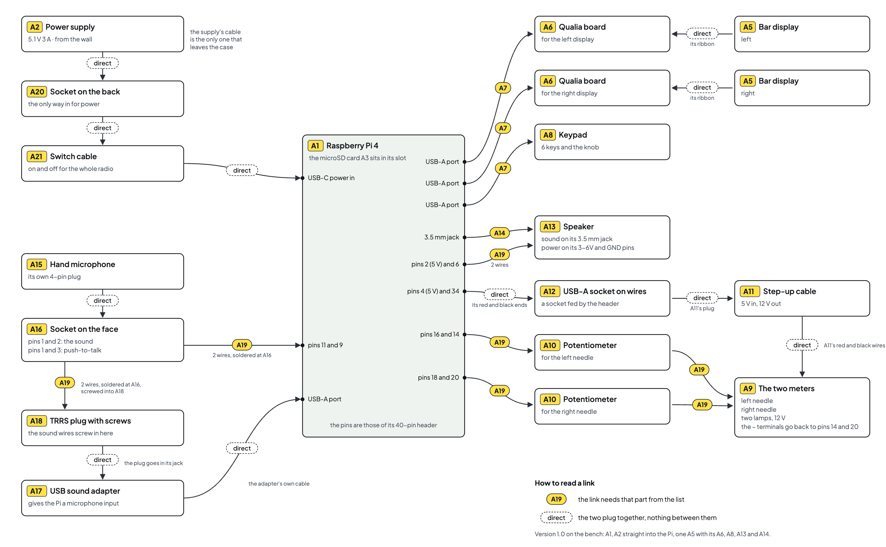
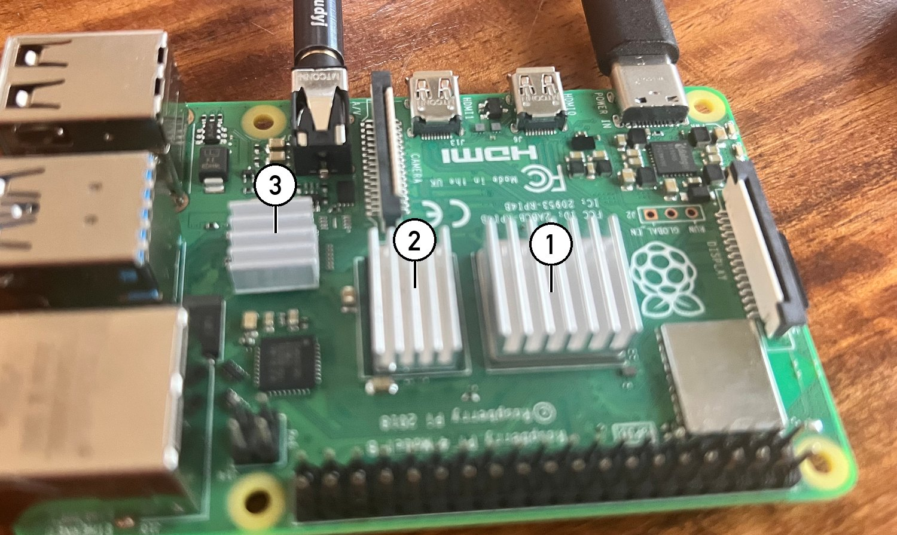
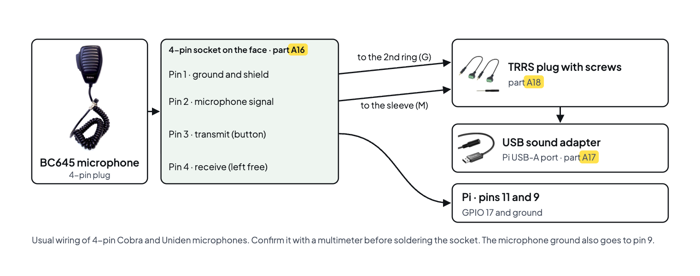
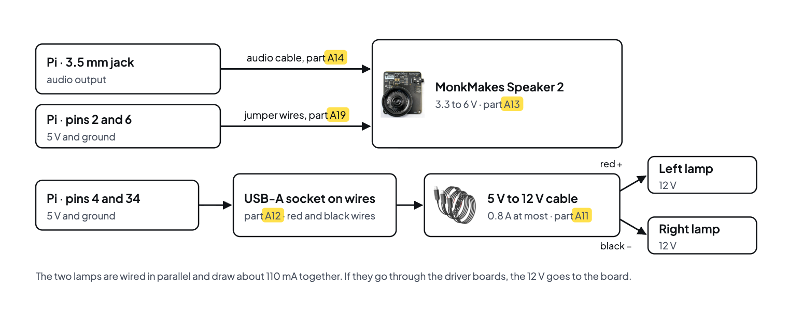
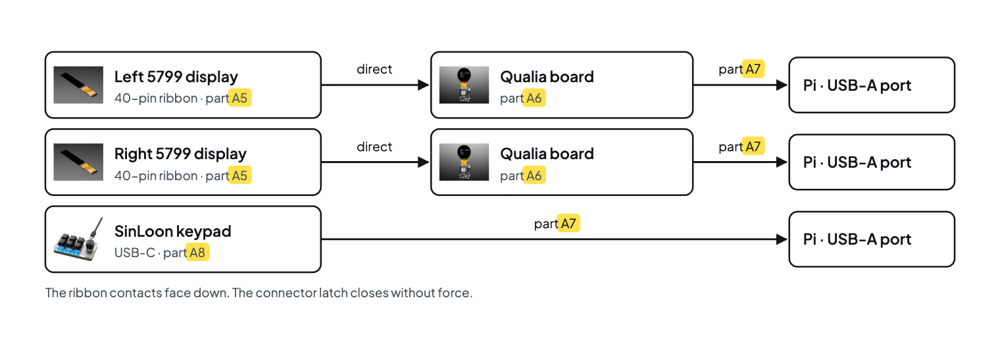

# Wiring

This guide has two parts. The first is the bench build of version 1.0: seven connections, none of them soldered. The
second is the plan for the whole radio, with its meters, its microphone and its second screen. I have built and tested
the first part. The second part is a design that I have not built yet.

The drawings and the tables name each part by its label in [the parts list](BOM.md), from A1 to A21.

## How the parts connect

Every part connects to the Raspberry Pi. Its four USB-A ports serve the keypad, the sound adapter and the two Qualia
boards. Its header of 40 pins serves the two needles, the push-to-talk button, the speaker's power and the power of
the meters' lamps.

Version 1.0 connects the keypad, one display with its Qualia board, and the speaker. On the bench the power supply
plugs straight into the Pi. In the finished radio it plugs into a socket on the back, and a switch cable inside takes
the power on to the Pi. [Power](#power) shows that path.

## Every part and every link

Each link is marked one of two ways. A yellow chip names the part from [the parts list](BOM.md) that makes the link.
"direct" means the two plug into each other with nothing between them.

Five parts are there only to make a link, and the drawing shows where each one sits.

| Part | Why the radio needs it |
|---|---|
| A14, the audio cable | The speaker takes its sound on a 3.5 mm jack. A14 takes it there from the Pi's own 3.5 mm jack. The two A19 wires on pins 2 and 6 give the speaker its power only. |
| A17, the USB sound adapter | The Pi has a sound output and no microphone input. A17 plugs into a USB-A port and adds one. |
| A18, the TRRS plug with screws | It is the plug that goes into A17's jack. The two sound wires of the microphone socket A16 are screwed into it. |
| A12, the USB-A socket on wires | The Pi's four USB-A ports are taken: two Qualia boards, the keypad and A17. A12 is a fifth socket, for power only, fed by pins 4 and 34 of the header. |
| A11, the step-up cable | The meters' lamps need 12 V. A11 plugs into A12, takes its 5 V and gives 12 V on two wires that go to the lamps. It comes in a pack of 3, and the radio uses one. |

No cable goes to a computer. The radio works alone and joins the network over the Pi's Wi-Fi.

## Version 1.0 on the bench

Unplug the Pi's power before you connect or move a wire.

| From | To | With |
|---|---|---|
| The power supply (A2) | The Pi's USB-C port, marked POWER IN | The supply's own cable |
| A USB-A port of the Pi | The USB-C port of the Qualia board (A6) | A USB-A to USB-C cable (A7) |
| The bar display's ribbon (A5) | The long connector of the Qualia board | The ribbon itself |
| A USB-A port of the Pi | The keypad's USB-C port (A8) | A USB-A to USB-C cable (A7), or the keypad's own cable |
| The Pi's 3.5 mm jack, marked A/V | The speaker's 3.5 mm jack (A13) | The audio cable (A14) |
| The Pi's pin 2 (5 V) | The speaker's pin **3-6V** | A female-to-female jumper wire (A19) |
| The Pi's pin 6 (ground) | The speaker's pin **GND** | A female-to-female jumper wire (A19) |

Any USB-A port of the Pi works for the screen board and for the keypad.

### The screen's ribbon

The ribbon is a thin film with gold contacts, and it slides into the connector without a plug. Lift the dark latch of
the Qualia board's long connector with a fingernail. Slide the ribbon in straight, contacts facing the board, until it
stops. Push the latch back down. If the latch resists, the ribbon is crooked: open it and start again. Keep the
display flat on the table and do not fold the ribbon.

### The speaker's power

The audio cable brings the sound and nothing else. The speaker's amplifier needs 3 to 6 V, and it takes them from two
pins of the Pi.

The two pins are in the outer row of the Pi's long header, the row on the edge of the board. They are at the end next
to the corner hole and the silver Wi-Fi shield, which is the end away from the USB ports. Counting from that corner,
pin 2 is the first pin and pin 6 is the third.

On the speaker, the pin marked **3-6V** is the one beside the audio jack and the pin marked **GND** is at the other
end of the row. The two pins between them, PWM and LINE, stay free.

  
  

Never connect 5 V to GND. Check both ends of each wire before you plug the power back in. When the speaker has power,
the small light on its board comes on.

### The heat sinks

Stick the three heat sinks on with the Pi unplugged. Peel the film, place each one straight and press firmly.
They do not come off cleanly, so place them once.

1. The largest goes on the processor, the square metal chip in the middle.
2. The next one goes on the memory chip beside it.
3. The smallest goes on the USB controller, the chip near the USB ports.

The silver box in the corner is the Wi-Fi shield. Nothing goes on it.

## The pins of the Pi

The numbers follow the physical numbering of the header. The drawing looks at the Pi from above, with its USB ports
on the right.

| Pins | Use | In version 1.0 |
|---|---|---|
| 2 (5 V) and 6 (ground) | The speaker's power | Wired |
| 4 (5 V) and 34 (ground) | The meters' lamps, through the USB-A socket on wires and the 5 V to 12 V cable | Planned |
| 11 (GPIO 17) and 9 (ground) | The microphone's push-to-talk button | Planned |
| 16 (GPIO 23) and 14 (ground) | The SIGNAL needle, the left meter | Planned |
| 18 (GPIO 24) and 20 (ground) | The AUDIO needle, the right meter | Planned |

Version 1.0 uses pins 2 and 6 only. No program drives the other pins yet.

## The plan for the whole radio

**This part is a design. I have not wired or tested any of it.** It is here so the case, the parts list and the
programs to come stay in step, and so anyone who builds ahead of me knows what I intend.

### The two needles

Each meter reaches the end of its scale at 500 µA. The Pi's pins give 3.3 V, so a needle reaches the end of its scale
with about 6.6 kΩ in series. One 10 kΩ potentiometer sits in series with each meter to set that value. The plan is to
start with each potentiometer at its 10 kΩ maximum, send the largest signal, then lower the resistance until the
needle reaches the end of its scale.

Each needle takes three A19 wires: pin to potentiometer, potentiometer to the meter's + terminal, and the meter's −
terminal back to a ground pin. The potentiometer's pins take the wires' sockets directly. I have not checked how a
wire holds on the meter's terminals. If they are screws, cut one end of the wire, strip it and hold it under the nut.

### The microphone and its push-to-talk button

The microphone (A15) keeps its 4-pin plug and plugs into a socket on the face (A16). Behind the face, its signal
reaches the USB sound adapter (A17) through the TRRS plug with screw terminals (A18). The push-to-talk button closes a contact
that the Pi reads on pin 11.

The four pins follow the usual wiring of Cobra and Uniden microphones: pin 1 is the ground and the shield, pin 2 the
microphone's signal, pin 3 transmit and pin 4 receive. I read that wiring on a reference page and have not checked it
on my own microphone. Check yours with a multimeter before you solder the socket.

### The sound and the lamps

The speaker's two connections are those of version 1.0. The lamps of the meters need 12 V. The step-up cable (A11) makes
them from the 5 V of pins 4 and 34, which it reaches through a USB-A socket on jumper wires (A12). The red wire of that
socket goes to pin 4 and its black wire to pin 34. Its green and white wires stay free and insulated.

### The two displays and the keypad

Each display connects to its own Qualia board through its ribbon, and each board uses one USB-A port of the Pi. The
keypad and the sound adapter use the other two ports.

The two displays sit end to end behind the window, with their ribbons pointing outward. Their lit areas are then
2.5 mm apart and cover 185.4 mm of the 212 mm window.

### Every connection

| From | To | Through |
|---|---|---|
| The power supply (A2) | The socket on the back of the case (A20) | The supply's own cable |
| The socket on the back | The switch cable (A21), then the Pi's USB-C port | The socket's own 30 cm cable |
| The Pi, a USB-A port | The keypad | A USB-A to USB-C cable (A7) |
| The Pi, a USB-A port | The sound adapter, then the TRRS plug | The adapter's cable (A17), then the plug (A18) |
| The Pi, a USB-A port | A Qualia board, then the left display | A USB-A to USB-C cable (A7), then the ribbon |
| The Pi, a USB-A port | A Qualia board, then the right display | A USB-A to USB-C cable (A7), then the ribbon |
| The Pi, pins 16 and 14 | The left meter, + and - terminals | Jumper wires, with a potentiometer on the + terminal |
| The Pi, pins 18 and 20 | The right meter, + and - terminals | Jumper wires, with a potentiometer on the + terminal |
| The microphone socket, pin 1 | The TRRS plug's second ring, and the Pi's pin 9 | Wires soldered to the socket |
| The microphone socket, pin 2 | The TRRS plug's sleeve | A wire soldered to the socket |
| The microphone socket, pin 3 | The Pi's pin 11 | A wire soldered to the socket |
| The Pi's 3.5 mm jack | The speaker | The audio cable (A14) |
| The Pi, pins 2 and 6 | The speaker, 5 V and ground | Jumper wires (A19) |
| The Pi, pins 4 and 34 | The lamps of the two meters | The USB-A socket on wires (A12), then the 5 V to 12 V cable (A11) |

### Power

One cable powers the whole radio: the cable of the power supply (A2). Nothing else leaves the case.

| Step | Part | What happens |
|---|---|---|
| 1 | The power supply (A2) | 5.1 V and 3 A from the wall |
| 2 | The socket on the back (A20) | The supply plugs in from outside. The socket's 30 cm cable takes the power inside. |
| 3 | The switch cable (A21) | One click turns the whole radio on or off. Its red light shows when the power is on. |
| 4 | The Pi (A1) | It takes the power on its USB-C port and passes it on to every other part |
| 5 | The Pi's four USB-A ports | The two Qualia boards with their displays, the keypad and the sound adapter |
| 6 | The Pi's header, pins 2 and 6 | The speaker |
| 7 | The Pi's header, pins 4 and 34 | The step-up cable, through the USB-A socket on wires, then the meters' lamps at 12 V |

The switch cable can sit in two places. On the supply's cable, outside the case, it works without any change to the
case. Inside the case, between the socket and the Pi, its button has to reach the back through a hole, and the case
has no hole or holder for it yet. The case has no hole for the socket either: it needs a round hole of 21.5 to 27 mm in
the back. [The case](../print/README.md#what-is-not-drawn-yet) lists both.

The supply gives 3 A. Two figures say how that splits. The two lamps draw about 110 mA at 12 V, going by their driver
boards. A Pi 4 gives its four USB-A ports 1.2 A in all, going by Raspberry Pi's hardware documentation. Taking the
lamps' power from the header leaves that 1.2 A to the two displays, the keypad and the sound adapter.

I have not built this path yet, and I have not measured what the finished radio draws. The socket and the switch
cable add about 60 cm of cable between the supply and the Pi. On the first start, run `vcgencmd get_throttled` on the
Pi: `throttled=0x0` means the voltage held.
