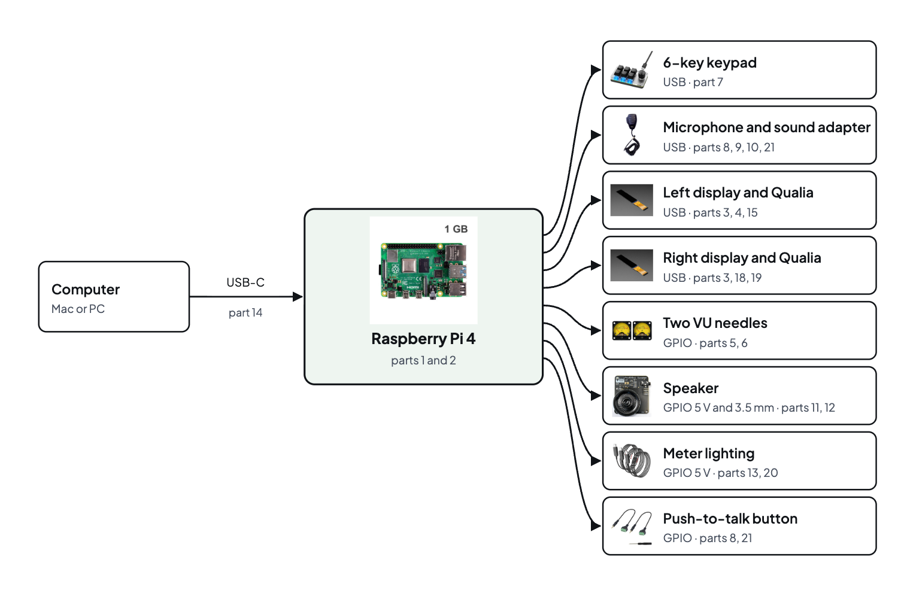
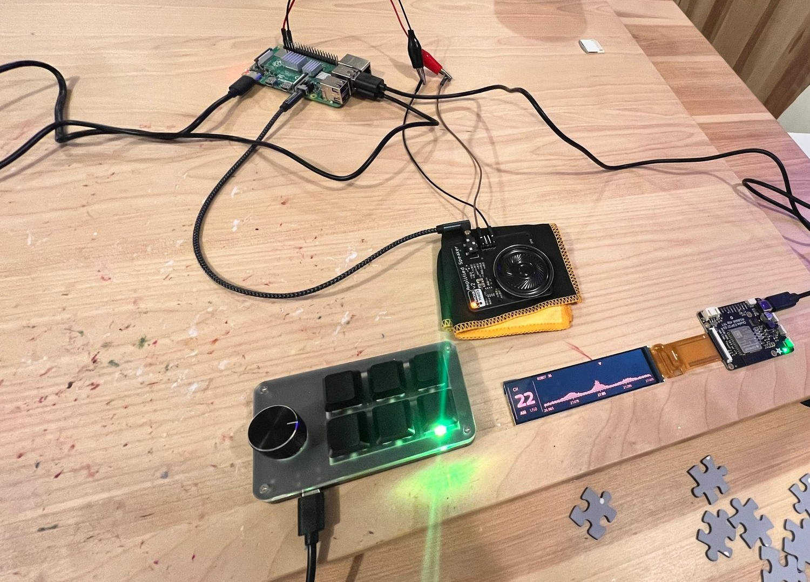
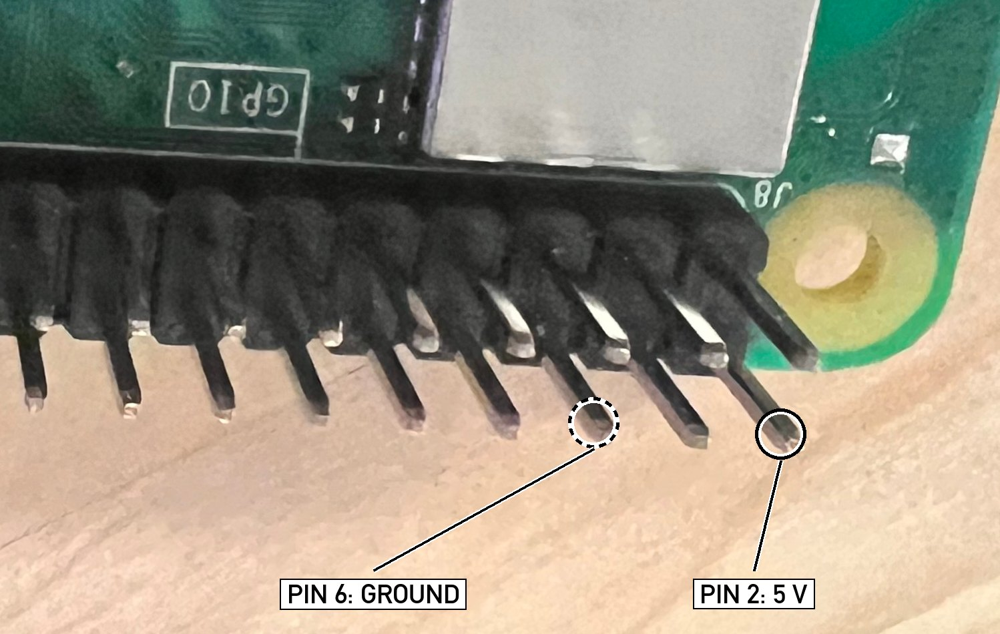
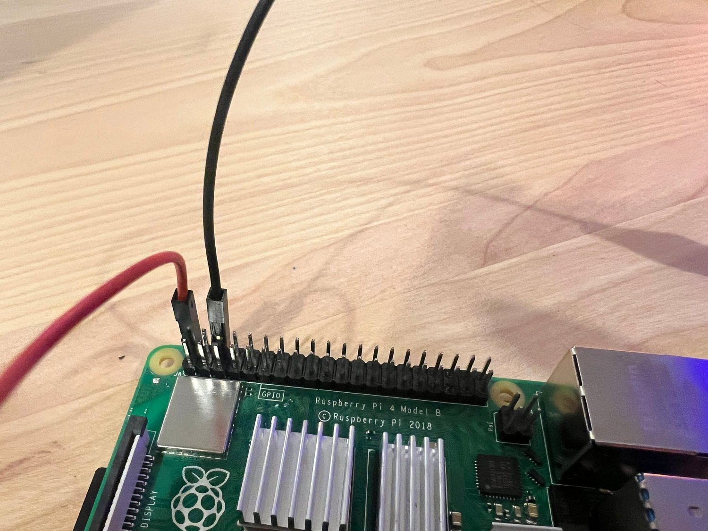
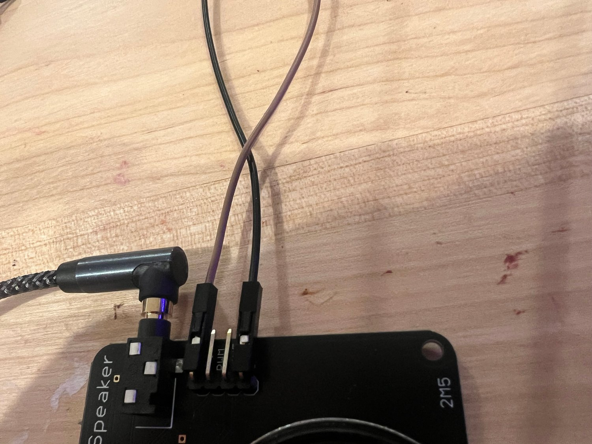
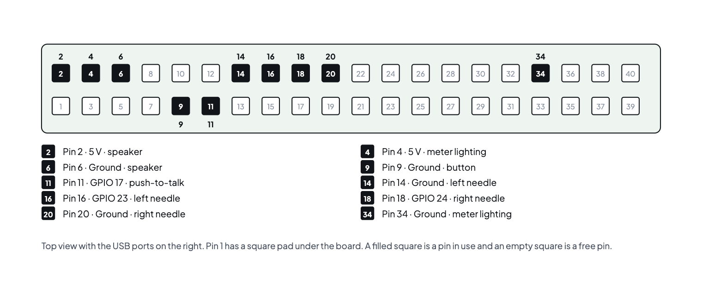
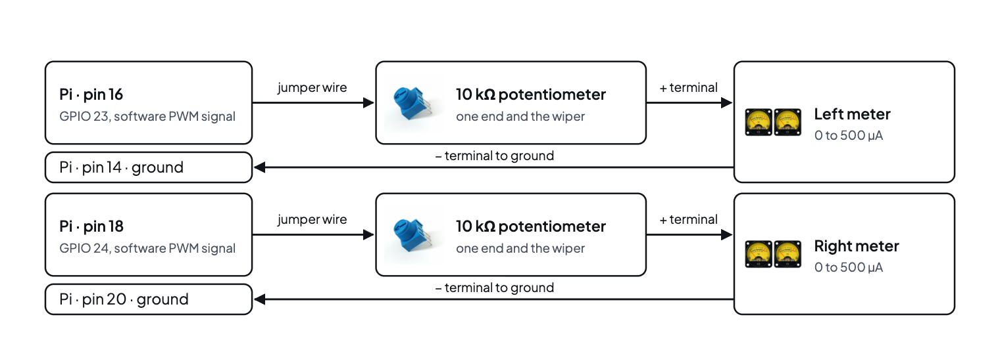
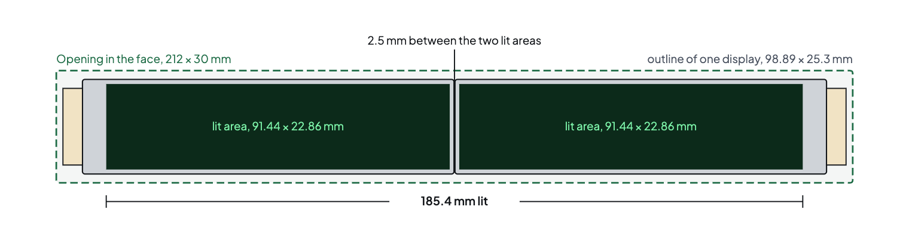

# Wiring

This guide has two parts. The first is the bench build of version 1.0: seven connections, none of them soldered. The
second is the plan for the whole radio, with its meters, its microphone and its second screen. I have built and tested
the first part. The second part is a design that I have not built yet.

The drawings name each part by its number in [the parts list](BOM.md).

## How the parts connect

Every part connects to the Raspberry Pi. Its four USB-A ports serve the keypad, the sound adapter and the two Qualia
boards. Its header of 40 pins serves the two needles, the push-to-talk button, the speaker's power and the power of
the meters' lamps.

Version 1.0 connects the keypad, one display with its Qualia board, and the speaker. On the bench the Pi takes its
power from its wall supply. The finished radio takes it from a computer, through the one USB-C cable that leaves the
case.

## Version 1.0 on the bench

Unplug the Pi's power before you connect or move a wire.

| From | To | With |
|---|---|---|
| The 5.1 V 3 A power supply | The Pi's USB-C port, marked POWER IN | The supply's own cable |
| A USB-A port of the Pi | The USB-C port of the Qualia board (part 4) | The USB-A to USB-C cable (part 15) |
| The bar display's ribbon (part 3) | The long connector of the Qualia board | The ribbon itself |
| A USB-A port of the Pi | The keypad's USB-C port (part 7) | The keypad's cable |
| The Pi's 3.5 mm jack, marked A/V | The speaker's 3.5 mm jack (part 11) | The audio cable (part 12) |
| The Pi's pin 2 (5 V) | The speaker's pin **3-6V** | A lead (part 16) |
| The Pi's pin 6 (ground) | The speaker's pin **GND** | A lead (part 16) |

Any USB-A port of the Pi works for the screen board and for the keypad.

### The screen's ribbon

The ribbon is a thin film with gold contacts, and it slides into the connector without a plug. Lift the dark latch of
the Qualia board's long connector with a fingernail. Slide the ribbon in straight, contacts facing the board, until it
stops. Push the latch back down. If the latch resists, the ribbon is crooked: open it and start again. Keep the
display flat on the table and do not fold the ribbon.

### The speaker's power

The audio cable brings the sound and nothing else. The speaker's amplifier needs 3 to 6 V, and it takes them from two
pins of the Pi.

The two pins are in the outer row of the Pi's long header, the row on the edge of the board. They are at the end next
to the corner hole and the silver Wi-Fi shield, which is the end away from the USB ports. Counting from that corner,
pin 2 is the first pin and pin 6 is the third.

On the speaker, the pin marked **3-6V** is the one beside the audio jack and the pin marked **GND** is at the other
end of the row. The two pins between them, PWM and LINE, stay free.

  
  

Never connect 5 V to GND. Check both ends of each lead before you plug the power back in. When the speaker has power,
the small light on its board comes on.

### The heat sinks

Stick the three heat sinks on with the Pi unplugged. Peel the film, place each one straight and press firmly.
They do not come off cleanly, so place them once.

1. The largest goes on the processor, the square metal chip in the middle.
2. The next one goes on the memory chip beside it.
3. The smallest goes on the USB controller, the chip near the USB ports.

The silver box in the corner is the Wi-Fi shield. Nothing goes on it.

## The pins of the Pi

The numbers follow the physical numbering of the header. The drawing looks at the Pi from above, with its USB ports
on the right.

| Pins | Use | In version 1.0 |
|---|---|---|
| 2 (5 V) and 6 (ground) | The speaker's power | Wired |
| 4 (5 V) and 34 (ground) | The meters' lamps, through the USB-A socket on wires and the 5 V to 12 V cable | Planned |
| 11 (GPIO 17) and 9 (ground) | The microphone's push-to-talk button | Planned |
| 16 (GPIO 23) and 14 (ground) | The SIGNAL needle, the left meter | Planned |
| 18 (GPIO 24) and 20 (ground) | The AUDIO needle, the right meter | Planned |

Version 1.0 uses pins 2 and 6 only. No program drives the other pins yet.

## The plan for the whole radio

**This part is a design. I have not wired or tested any of it.** It is here so the case, the parts list and the
programs to come stay in step, and so anyone who builds ahead of me knows what I intend.

### The two needles

Each meter reaches the end of its scale at 500 µA. The Pi's pins give 3.3 V, so a needle reaches the end of its scale
with about 6.6 kΩ in series. One 10 kΩ potentiometer sits in series with each meter to set that value. The plan is to
start with each potentiometer at its 10 kΩ maximum, send the largest signal, then lower the resistance until the
needle reaches the end of its scale.

### The microphone and its push-to-talk button

The microphone keeps its 4-pin plug and plugs into a socket on the face (part 21). Behind the face, its signal
reaches the USB sound adapter through the TRRS plug with screw terminals. The push-to-talk button closes a contact
that the Pi reads on pin 11.

The four pins follow the usual wiring of Cobra and Uniden microphones: pin 1 is the ground and the shield, pin 2 the
microphone's signal, pin 3 transmit and pin 4 receive. I read that wiring on a reference page and have not checked it
on my own microphone. Check yours with a multimeter before you solder the socket.

### The sound and the lamps

The speaker's two connections are those of version 1.0. The lamps of the meters need 12 V. The step-up cable makes
them from the 5 V of pins 4 and 34, which it reaches through a USB-A socket on jumper wires. The red wire of that
socket goes to pin 4 and its black wire to pin 34. Its green and white wires stay free and insulated.

### The two displays and the keypad

Each display connects to its own Qualia board through its ribbon, and each board uses one USB-A port of the Pi. The
keypad and the sound adapter use the other two ports.

The two displays sit end to end behind the window, with their ribbons pointing outward. Their lit areas are then
2.5 mm apart and cover 185.4 mm of the 212 mm window.

### Every connection

| From | To | Through |
|---|---|---|
| The computer | The Pi's USB-C port | The USB-C cable (part 14) |
| The Pi, a USB-A port | The keypad | The keypad's cable (part 7) |
| The Pi, a USB-A port | The sound adapter, then the TRRS plug | The adapter's cable (parts 9 and 10) |
| The Pi, a USB-A port | A Qualia board, then the left display | A USB cable (part 15), then the ribbon |
| The Pi, a USB-A port | A Qualia board, then the right display | A USB cable (part 19), then the ribbon |
| The Pi, pins 16 and 14 | The left meter, + and - terminals | Jumper wires, with a potentiometer on the + terminal |
| The Pi, pins 18 and 20 | The right meter, + and - terminals | Jumper wires, with a potentiometer on the + terminal |
| The microphone socket, pin 1 | The TRRS plug's second ring, and the Pi's pin 9 | Wires soldered to the socket |
| The microphone socket, pin 2 | The TRRS plug's sleeve | A wire soldered to the socket |
| The microphone socket, pin 3 | The Pi's pin 11 | A wire soldered to the socket |
| The Pi's 3.5 mm jack | The speaker | The audio cable (part 12) |
| The Pi, pins 2 and 6 | The speaker, 5 V and ground | Jumper wires (part 16) |
| The Pi, pins 4 and 34 | The lamps of the two meters | The USB-A socket on wires (part 20), then the 5 V to 12 V cable (part 13) |

### Power

The computer's USB-C port is meant to power the whole radio. Two figures frame that plan. The two lamps draw about
110 mA at 12 V, going by their driver boards. A Pi 4 gives its four USB-A ports 1.2 A in all, going by Raspberry Pi's
hardware documentation. Taking the lamps' power from the header leaves that 1.2 A to the two displays, the keypad
and the sound adapter. I have not measured what the finished radio draws.
