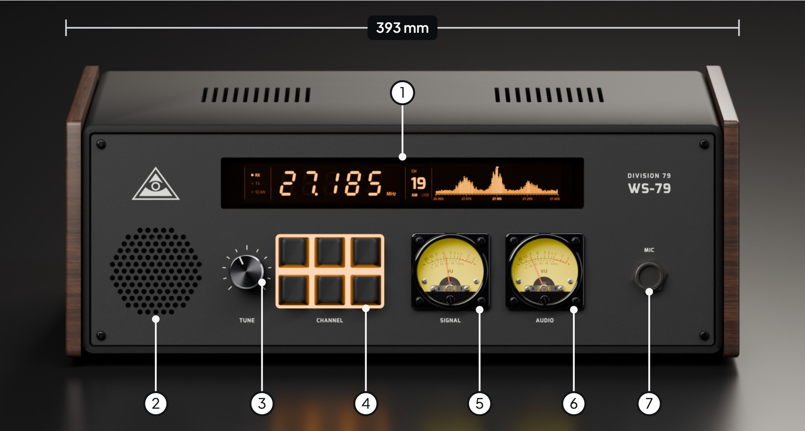
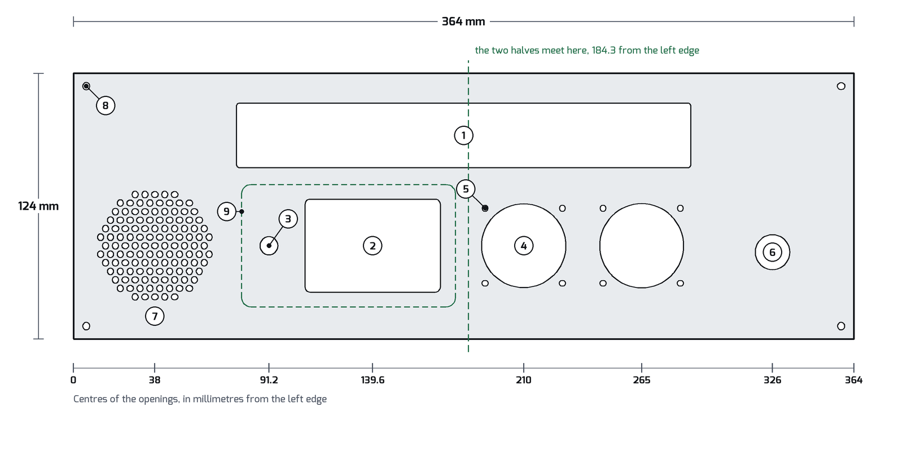
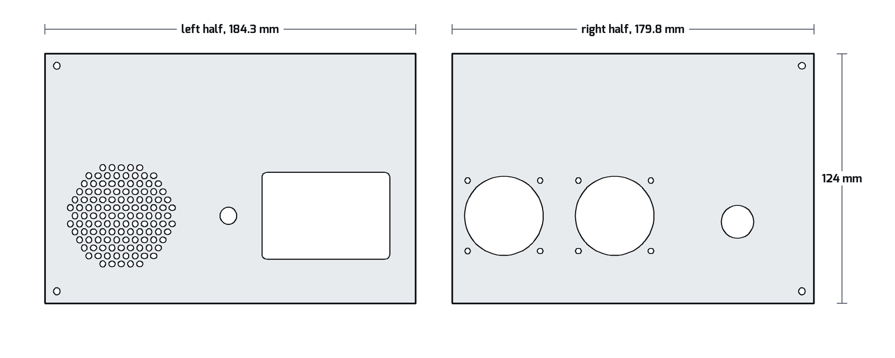
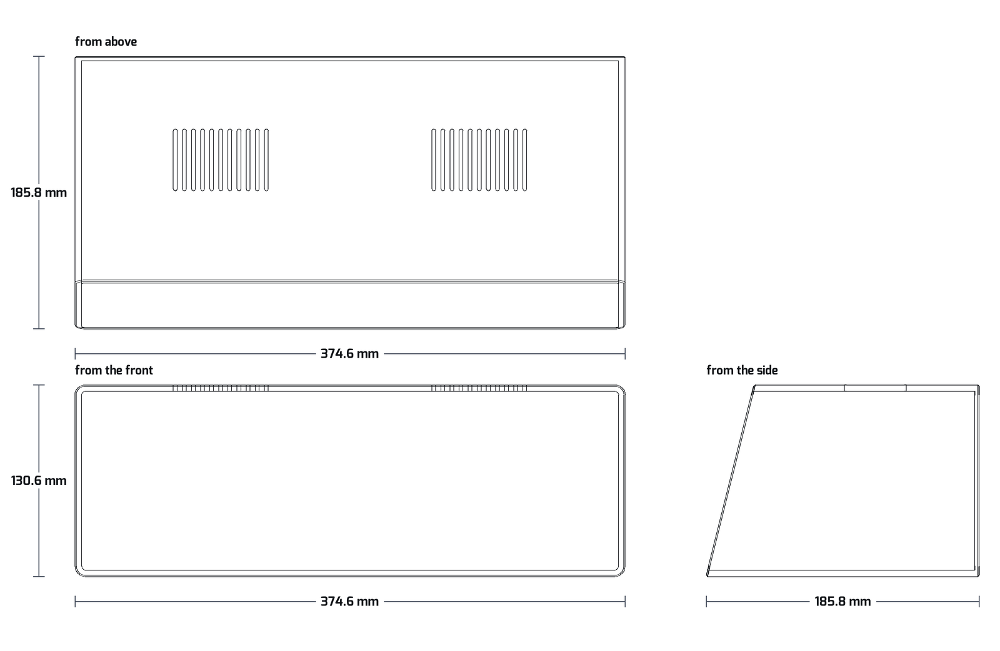
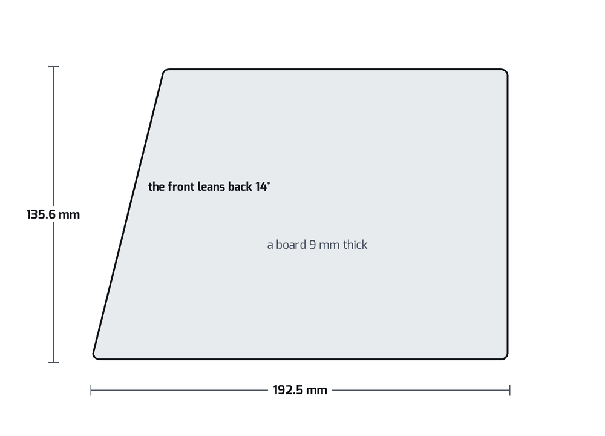
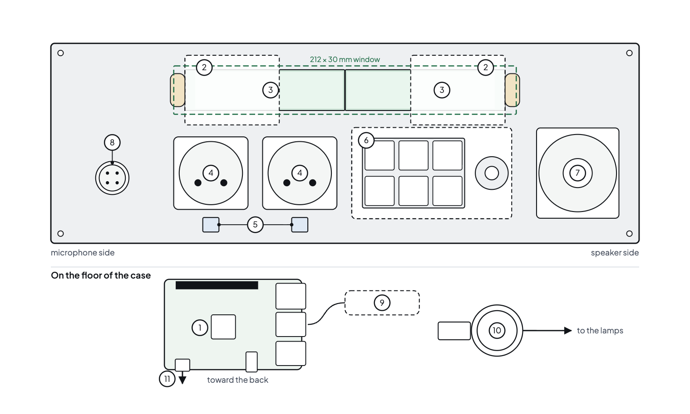

# The case

The case is a wedge: a face that leans back 14 degrees, a shell behind it, and a board on each side. Assembled, the
radio is 393 mm wide and 193 mm deep, and it stands about 142 mm tall on its feet.

**These files are drafts.** Each part is a closed mesh that a slicer can open. No part has been sliced or printed
yet, and the inside of the case is not drawn. This page gives everything I know about the case today: its sizes,
every opening of its face, how each part is meant to print, and what is still missing.



| Mark | On the face | Part in [the parts list](../docs/PARTS-BOM.md) |
|---|---|---|
| 1 | The window of the two bar displays | 3 |
| 2 | The speaker grille | 11, behind the face |
| 3 | The knob of the keypad | 7 |
| 4 | The six keys of the keypad | 7 |
| 5 | The SIGNAL meter | 5 |
| 6 | The AUDIO meter | 5 |
| 7 | The socket of the hand microphone | 21 |

The picture is a render of the 3D model in [`model/`](../model/README.md). The model is drawn from the size of each
part, read on its maker's page or measured on a photo.

## The parts to make

All sizes are in millimetres. The table is measured on the print files themselves.

<!-- case_plans:parts -->
| Part | File | Size in mm | Volume | To make |
|---|---|---|---|---|
| Face, in one piece | `ws79_front_panel_draft.stl` | 364 × 124 × 3 | 91.5 cm³ | 1, or the two halves |
| Face, left half | `ws79_front_panel_left.stl` | 184.3 × 124 × 3 | 42 cm³ | 1, with the right half |
| Face, right half | `ws79_front_panel_right.stl` | 179.8 × 124 × 3 | 49.4 cm³ | 1, with the left half |
| Shell | `ws79_shell_draft.stl` | 374.6 × 185.8 × 130.6 | 857.9 cm³ | 1 |
| Side | `ws79_side_draft.stl` | 192.5 × 135.6 × 9 | 215 cm³ | 2, the second one mirrored |
<!-- /case_plans:parts -->

One more part is cut from a sheet: the window, a pane of smoked acrylic of 211.5 × 29.5 mm. Its thickness is not
chosen yet.

The same parts come in two formats. `stl/` opens everywhere. `3mf/` keeps the units and opens in Bambu Studio,
PrusaSlicer and Cura. The model is made in Blender and the files are meshes: there is no STEP file, so a shop that
works from one has to redraw the part.

## The face

The face is a plate 3 mm thick, with corners rounded at 2.2 mm and a chamfer of 0.4 mm around its front edge. The
plan shows it from the front. Each number on the plan is a row of the table under it.



<!-- case_plans:openings -->
| No. | Opening | Size in mm | Centre, from the left edge | Centre, from the bottom edge | How many |
|---|---|---|---|---|---|
| 1 | Window of the two bar screens | 212 × 30 | 182 | 95 | 1 |
| 2 | Opening of the six keys | 63.3 × 43.3 | 139.6 | 43.5 | 1 |
| 3 | Hole of the knob | ⌀ 8.4 | 91.2 | 43.5 | 1 |
| 4 | Opening of a meter | ⌀ 39.2 | 210, 265 | 43.5 | 2 |
| 5 | Screw hole of a meter | ⌀ 2.8 | 192, 228, 247, 283 | 26, 61 | 8 |
| 6 | Hole of the microphone socket | ⌀ 16.2 | 326 | 40.5 | 1 |
| 7 | Hole of the speaker grille | ⌀ 3, in a pattern 53.6 across | 38 | 43.5 | 121 |
| 8 | Corner hole for an M3 screw | ⌀ 3.4 | 6, 358 | 6, 118 | 4 |
| 9 | Pocket for the keypad, on the back, 2 mm deep | 99.6 × 57.2 | 128.3 | 43.5 | 1 |
<!-- /case_plans:openings -->

Four things to know about these openings.

- **The six keys share one opening.** The keypad's frosted top shows 1.6 mm around the outer caps and between the
  caps, so the light under the keys glows through the face.
- **The keypad sits in a pocket.** The pocket is on the back of the face, 99.6 × 57.2 mm and 2 mm deep. It holds the
  keypad's frosted top 1 mm under the front of the face, so the light under the keys shows around the caps. The
  dashed line on the plan is its outline. The face prints with its front on the bed, so the pocket opens upward
  and needs no supports.
- **Each meter has four screw holes**, 36 mm apart one way and 35 mm the other.
- **The legends are not in the files.** TUNE, CHANNEL, SIGNAL, AUDIO and MIC, the emblem and the name plate are in the
  Blender model only. They are meant to be white: printed in two colours in the first layers, or engraved and
  filled.

### The face in two halves

The face is 364 mm long, which is more than most printers' beds. The two half files fit a bed of 220 mm. They meet
between the keys and the SIGNAL meter, and the window spans the joint.



Nothing holds the two halves together yet: the joint between them is not drawn.

## The shell

The shell is the top, the bottom, the back and two inner walls in one piece, 3 mm thick. It is open at the front,
where its rim leans back 14 degrees and takes the face. Its top has 22 vent slots of 2.6 × 42 mm, in two
groups.



The file is the shell's outer shape. It has no opening for power yet. The plan is two round holes of 21.5 to 27 mm in
the back for the two sockets (A20): one takes the supply's cable, the other an optional cable to a PC. [WIRING.md](../docs/WIRING.md#power) shows the
path from that socket to the Pi.

## The sides

Each side is a flat board 9 mm thick, in the outline of the wedge. Cut the two boards from walnut, or print them.
The file is one side, and the other is its mirror.



## How the parts are meant to print

- **The face** prints flat, with its front against the bed.
- **The shell** prints standing on its front rim, in a left half and a right half. Its walls then lean 14 degrees,
  which aims at a print without supports. The file is still in one piece.
- **The sides** print flat, or are cut from a board.

None of this has been tried. The print settings are still to find.

## What the inside must hold

The drawing shows the face from inside the case, so left and right are swapped, then the parts that rest on the
floor at the same scale. It is to scale for the face and for every part whose maker publishes its size. The places of
the two Qualia boards and of the parts on the floor are a proposal.



| Mark | Part | Size in mm | What it needs |
|---|---|---|---|
| 1 | Raspberry Pi 4 (A1) | 85 × 56 | Four posts on the floor of the case |
| 2 | The two Qualia boards (A6) | 58 × 43 each | A rest behind each display, near its 50 mm ribbon |
| 3 | The two bar displays (A5) | 98.89 × 25.3 each | A carrier behind the window, the two end to end |
| | The window of smoked acrylic | 211.5 × 29.5 | A rebate behind the face |
| 4 | The two meters (A9) | 46 × 48 × 46 each | Their four screws in the face |
| 5 | The two potentiometers (A10) | | They hang on their wires. A cable tie is enough. |
| 6 | The keypad (A8) | Body of 99 × 56.6, measured on a photo | Its pocket in the back of the face, and a mount that holds it there |
| 7 | The speaker (A13) | 51 × 56 × 61 | A mount behind the grille |
| 8 | The microphone socket (A16) | Hole of 16.2 | Its nut on the face |
| 9 | The USB sound adapter (A17) | | It hangs on its cable. A cable tie is enough. |
| 10 | The 5 V to 12 V cable and its USB-A socket (A11 and A12) | | A place on the floor, coiled |
| 11 | The Pi's USB-C port, with the splitter (A23) plugged in | | The switch cable (A21) runs from the power socket on the back to the splitter's PWR ONLY side, and the PC socket's cable to its DATA ONLY side |

The two displays sit end to end behind the window. [WIRING.md](../docs/WIRING.md) shows them to scale.

## What is not drawn yet

- The posts that hold the Pi and the two Qualia boards.
- The carrier that holds the two displays and the window.
- The mounts of the keypad and of the speaker.
- The joint between the two halves of the face, and the joint between the two halves of the shell.
- The back as a plate of its own.
- The two round holes of 21.5 to 27 mm for the sockets (A20) in the back, power and PC. The shell's print file has no
  opening for them yet.
- A slot and a holder for the rocker of the switch cable (A21), if the switch goes inside the case. On the supply's
  cable, outside the case, it needs neither.
- The feet. They are in the model and not in the print files.
- The legends of the face.

## What to measure before you print

Three sets of openings were measured on photos of the parts: those of the six keys and the knob with the keypad's
pocket, those of the two meters, and the hole of the microphone socket. I have not measured the parts themselves.
Measure your own parts against the table of the face before you print it. I drew the hole of the 4-pin socket
from its listing.

## Redrawing the plans

The drawings and the two tables of this page are made from the print files:

```bash
python3 tools/case_plans.py             # the drawings, and the two tables of this page
python3 tools/case_plans.py --tables    # the tables alone, on the screen
```

A test checks that this page holds the tables the script writes, so the page cannot drift from the files.
